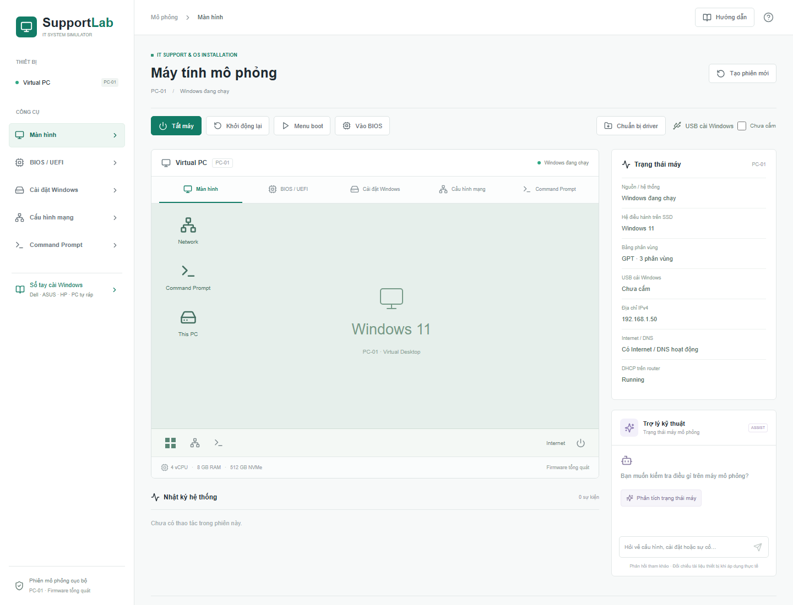
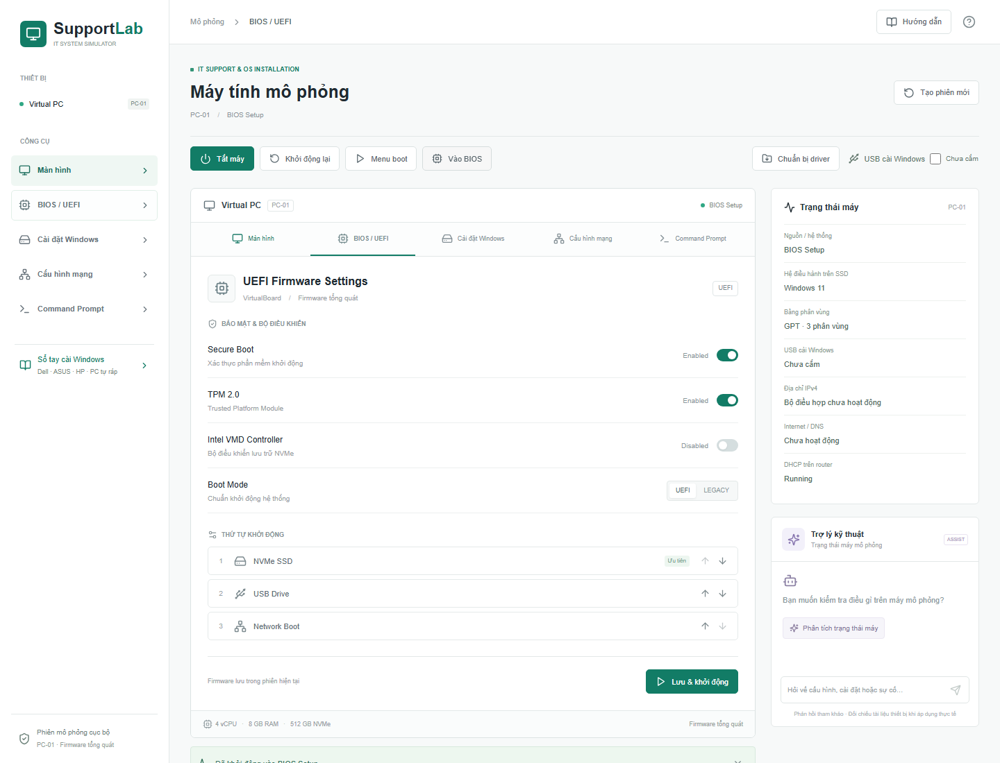
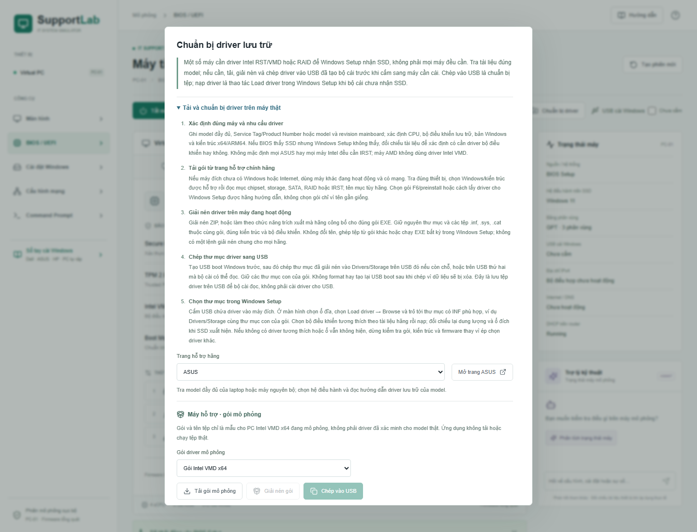
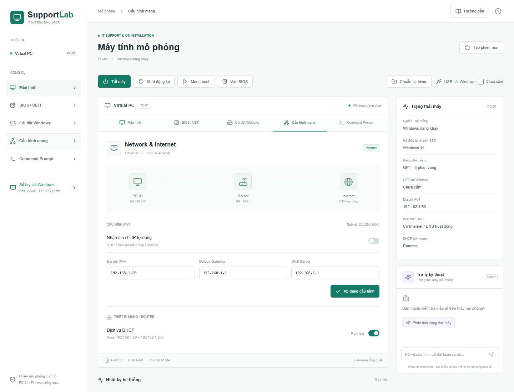
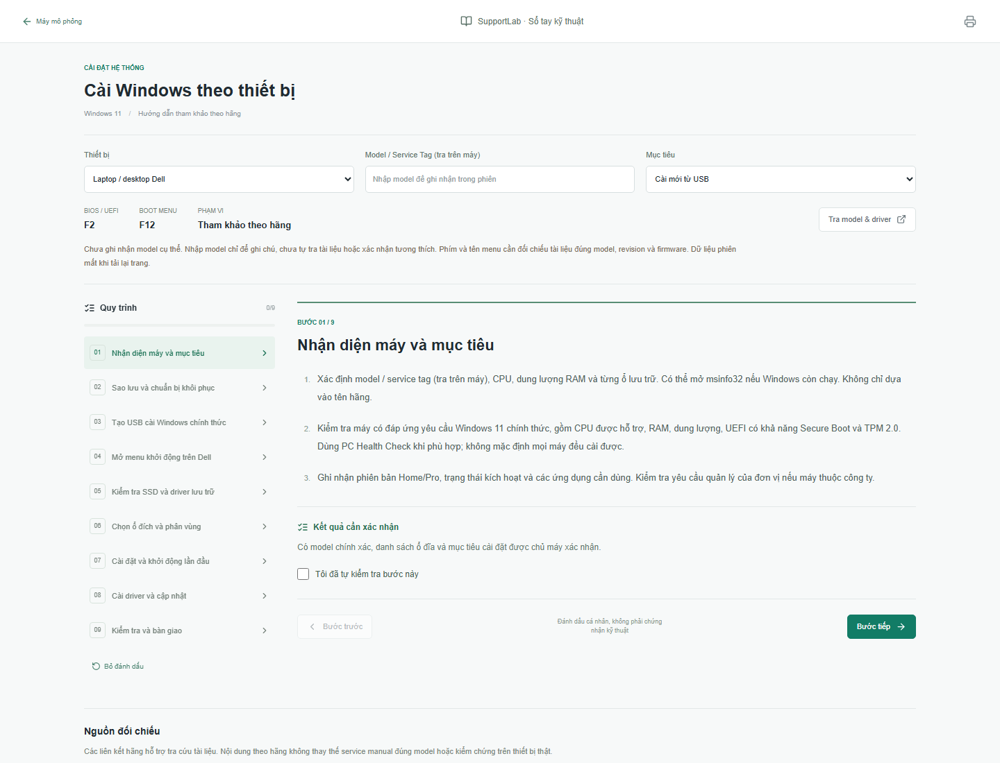

# SupportLab · Mô phỏng IT Support

Nền tảng Web mô phỏng cài đặt hệ thống và xử lý sự cố CNTT, tích hợp trợ lý AI tùy chọn. Đây là bản mẫu nghiên cứu phục vụ định hướng khóa luận, tập trung vào cài Windows và xử lý sự cố mạng cơ bản.

Người dùng tự thay đổi cấu hình và quan sát kết quả trên máy tính mô phỏng. Ứng dụng không tổ chức bài tập, chấm điểm hay tự động sửa lỗi.



> Đây là mô phỏng bằng trạng thái phần mềm, không phải máy ảo chạy Windows thật. Các thao tác không thay đổi BIOS, ổ đĩa, USB hoặc mạng của máy đang mở trình duyệt.

## Chức năng hiện có

| Thành phần | Nội dung |
| --- | --- |
| Máy tính mô phỏng | Máy có Windows hoặc máy trống; bật, tắt, khởi động lại và tạo phiên mới. |
| BIOS / UEFI | Secure Boot, TPM, UEFI/Legacy, Intel VMD và thứ tự khởi động. |
| Menu boot | Chọn USB hoặc SSD cho một lần khởi động, không đổi thứ tự boot đã lưu. |
| Cài Windows | Nhận SSD theo trạng thái bộ điều khiển, chuẩn bị GPT/phân vùng và cài Windows mô phỏng. |
| Driver lưu trữ | Mô phỏng tải, giải nén, chép USB, duyệt thư mục và nạp driver tương thích. |
| Mạng và CMD | Chỉnh IP, gateway, DNS, DHCP; kiểm tra bằng các lệnh mô phỏng. |
| Hướng dẫn làm cùng | Gợi ý theo trạng thái hiện tại, chỉ vị trí thao tác và giải thích lý do. |
| Sổ tay kỹ thuật | Tham khảo cài Windows cho Dell, ASUS, HP và PC tự ráp. |
| Trợ lý kỹ thuật | Giải thích cục bộ hoặc kết nối OpenAI khi được cấu hình. |

## Công nghệ

Next.js 15 (App Router), React 19, TypeScript, Tailwind CSS, Lucide React, Zustand và Zod. Kiểm thử bằng Node.js Test Runner qua `tsx` và Playwright.

## Cài đặt và chạy

Yêu cầu **Node.js 20.9 trở lên**, npm và Git nếu tải bằng lệnh clone.

```sh
git clone https://github.com/phanduyan134-coder/MoPhongITSUPPORT.git
cd MoPhongITSUPPORT
npm install
npm run dev
```

Mở địa chỉ Local được in trong terminal, thường là **http://127.0.0.1:3000**. Next.js sẽ chọn cổng khác nếu cổng đó đã được dùng.

`npm install` cài thư viện; những lần chạy sau thường chỉ cần `npm run dev`. Không cần API key để sử dụng mô phỏng và hướng dẫn cục bộ.

Chạy bản tối ưu:

```sh
npm run build
npm start
```

Môi trường phát triển dùng `.next-dev`, bản build dùng `.next`, kiểm thử trình duyệt dùng `.next-e2e` để tránh ghi đè kết quả.

## Hình ảnh giao diện

Ảnh chụp trực tiếp từ bản mẫu, không phải giao diện BIOS thật của từng model.

### BIOS / UEFI

Cấu hình firmware tổng quát và quan sát ảnh hưởng tới khởi động, nhận SSD và cài đặt.



### Chuẩn bị driver

Hướng dẫn máy thật được tách biệt với các gói driver mẫu trong mô phỏng.



### Cấu hình mạng

Chỉnh IPv4 và dịch vụ DHCP trên router, sau đó kiểm tra bằng CMD mô phỏng.



### Sổ tay cài Windows

Chọn nhóm thiết bị và mục tiêu cài đặt để xem quy trình cùng cảnh báo.



## Sử dụng mô phỏng

### Cài Windows có hướng dẫn

1. Chọn **Tạo phiên mới**, chọn máy trống và xác nhận.
2. Bật **Hướng dẫn**, chọn **Cài Windows từ USB**.
3. Thực hiện gợi ý: cắm USB, vào BIOS, cấu hình firmware và boot USB.
4. Nếu VMD khiến bộ cài chưa nhận SSD, chuẩn bị và nạp driver mẫu.
5. Xác nhận chuẩn bị GPT/phân vùng khi muốn xóa ổ mô phỏng, rồi cài Windows.
6. Boot từ SSD và rút USB sau khi Windows mô phỏng đã chạy.

Hướng dẫn đọc trạng thái máy, không tiến bước bằng đánh dấu thủ công. Thay đổi cấu hình sẽ cập nhật gợi ý. **Chỉ vị trí thao tác** chỉ mở đúng màn hình và đưa tiêu điểm tới nút cần dùng; **Vì sao cần bước này?** giải thích cơ sở kỹ thuật.

Bật hướng dẫn không tự xóa ổ hay tạo phiên mới. Máy đã có Windows cần lựa chọn cài lại rõ ràng; Windows có sẵn không được coi là kết quả của lần cài theo hướng dẫn. Chuẩn bị phân vùng vẫn cần xác nhận riêng.

### Chuẩn bị và nạp driver

Trên máy thật, nếu cần driver lưu trữ, dùng máy đang hoạt động để tra **đúng model, bộ điều khiển, Windows và kiến trúc**, tải từ trang hãng, giải nén theo tài liệu rồi chép vào USB **sau khi đã tạo USB boot**. Không format hoặc tạo lại USB sau khi chép. USB chứa tệp để bộ cài đọc, không phải thiết bị được cài driver.

**Không phải máy nào cũng cần nạp driver để nhận SSD.** Nếu BIOS nhận ổ nhưng Windows Setup chưa nhận, kiểm tra gói lưu trữ phù hợp. Nếu BIOS cũng không nhận, cần kiểm tra thêm kết nối, phần cứng hoặc cấu hình. Không đổi RAID/VMD/AHCI tùy tiện trên máy có Windows hay RAID. AMD/ARM không dùng mặc định gói Intel VMD x64.

Trong mô phỏng Intel VMD x64:

1. Mở **Chuẩn bị driver**, chọn **Gói Intel VMD x64**.
2. Chọn **Tải gói mô phỏng**, **Giải nén gói**, kết nối USB rồi **Chép vào USB**.
3. Trong Windows Setup khi chưa thấy SSD, chọn **Nạp driver Intel VMD → Browse**.
4. Chọn `E:\Drivers\Storage`, xác nhận thư mục, chọn **Intel VMD Controller (x64)** rồi **Nạp driver**.

Gói Ethernet không tương thích bộ điều khiển lưu trữ. Nạp driver chỉ làm SSD xuất hiện, không format ổ. Tệp trên USB còn sau khi rút USB; driver tạm trong Setup cần nạp lại khi khởi động lại bộ cài. Driver của Windows đã cài được theo dõi riêng.

Tên tệp như `vmd-controller.inf`, ký tự ổ `E:` và đường dẫn chỉ là ví dụ. Ứng dụng không tải driver thật, giải nén thật, đọc USB, phân tích INF, kiểm tra Hardware ID/chữ ký hoặc thực thi driver. Bộ duyệt chỉ tìm trong thư mục chọn, không quét thư mục con. Liên kết hãng là cổng tra cứu, không tự tìm hay xác minh gói từng model. EXE cần cách trích xuất do hãng hướng dẫn, không có lệnh chung cho mọi gói. Driver Wi-Fi/LAN sau cài là các gói riêng.

### Kiểm tra và xử lý mạng

Trong **Hướng dẫn**, chọn **Kiểm tra và xử lý mạng**. Hướng dẫn bắt đầu từ `ipconfig /all`, rồi gợi ý kiểm tra theo trạng thái IP, gateway, DNS hoặc DHCP.

```text
ipconfig /all
ping 192.168.1.1
ping 192.168.1.10
ping 8.8.8.8
nslookup example.com
ipconfig /renew
ipconfig /flushdns
```

Nhập `help` trong CMD mô phỏng để xem các lệnh hỗ trợ. Đây không phải lệnh hệ thống hoặc lưu lượng mạng thật; kết nối IP và phân giải DNS được kiểm tra riêng.

Thay đổi trường mạng chỉ là bản nháp tới khi chọn **Áp dụng cấu hình**. Bật lại DHCP không tự gia hạn IP. Khi cấu hình, DHCP hoặc nguồn thay đổi và sau khi khởi động lại, quan sát chẩn đoán cũ bị vô hiệu hóa; lịch sử CMD vẫn giữ để tham khảo. Máy chưa có Windows không tạo kết quả kiểm tra mạng giả. Chuyển hướng dẫn không làm mất cấu hình máy hay lựa chọn cài lại Windows.

### Sổ tay và hồ sơ ASUS

Mở **Sổ tay cài Windows** hoặc `/handbook`: nhận diện thiết bị, sao lưu, BitLocker nếu có mã hóa, chuẩn bị USB, boot, driver, phân vùng và bàn giao. Có nhánh cài mới và cài lại từ Windows để giữ tệp/ứng dụng khi được hỗ trợ. Có thể in toàn bộ quy trình; dấu kiểm là ghi chú cá nhân, không chứng nhận đã thao tác đúng.

Danh mục ASUS ban đầu có X515EA, FA506NC, X1504VA, UX3405MA, D500ME và PRIME B760M-A WIFI D4, phân biệt laptop, desktop nguyên bộ và mainboard. Model không khớp dùng hướng dẫn tổng quát. Không suy ra VMD từ tên model; CPU được chọn thủ công và đặt lại khi đổi model, không tự phát hiện phần cứng.

Các hồ sơ hiện đều ở mức **tổng quát (`general`)**, chưa kiểm chứng cài đặt trên máy thật. Mở được trang tài liệu không đồng nghĩa quy trình đã được xác minh. Nguồn và mức kiểm chứng ghi tại `src/lib/asus-profiles.ts`; nâng lên `documented` hoặc `tested` cần bằng chứng đúng firmware, bản Windows, ngày và phạm vi.

<details>
<summary>Ghi chú đối chiếu nguồn</summary>

- Ngày 19/10/2026 đã tham khảo hướng dẫn vào BIOS ASUS, trang tải Windows 11 của Microsoft và ASUS FAQ 1044458 về driver theo nền tảng.
- Trang tài liệu X515EA và FA506NC được mở để xác nhận danh tính, chưa kiểm chứng firmware, driver hoặc cài đặt. Các liên kết model khác được đánh dấu chưa kiểm tra.
- Bài Dell trả HTTP 403, bài HP hết thời gian chờ và ASUS FAQ boot 1030858 trả 404. Phím tắt theo hãng là thông lệ tham khảo, không phải xác minh cho từng model.
- Danh mục không bao phủ mọi model ASUS. Kiểm tra tài liệu đúng model, revision và firmware trước khi áp dụng trên thiết bị thật.

</details>

## Trợ lý AI tùy chọn

Mặc định ứng dụng dùng giải thích cục bộ không cần API key. Để kết nối OpenAI, tạo `.env.local` dựa trên `.env.example`:

```dotenv
SUPPORTLAB_AI_ENABLED=true
OPENAI_API_KEY=
OPENAI_MODEL=
OPENAI_BASE_URL=https://api.openai.com/v1
```

Điền khóa riêng và model hỗ trợ Responses API mà tài khoản được phép dùng, rồi khởi động lại máy chủ. Ứng dụng không tự chọn model. **Không commit `.env.local`, API key hoặc nhập mật khẩu/khóa khôi phục BitLocker vào trò chuyện.**

Trợ lý chỉ đọc cấu hình máy mô phỏng và nhật ký/kết quả CMD để giải thích, không thay đổi máy hoặc thực thi lệnh hệ thống. Máy chủ kiểm tra snapshot bằng Zod; giới hạn tối đa 4 yêu cầu model và 30 giây/câu trả lời, 30 yêu cầu/phút trong một tiến trình. Lỗi nhà cung cấp được hiển thị; phản hồi cục bộ và OpenAI có nhãn riêng. Khóa giữ ở máy chủ.

Tham khảo: [Tài liệu Responses API chính thức](https://developers.openai.com/api/reference/resources/responses/methods/create/).

## Kiểm thử

```sh
npm test
npm run typecheck
npm run build
npx playwright install chromium
npm run test:e2e
```

Playwright dùng cổng `3100`, thư mục build riêng và trợ lý cục bộ. Ảnh kiểm thử ở `output/screenshots` không đẩy lên Git; ảnh giới thiệu ở `docs/images` được commit để GitHub hiển thị trong README.

## Cấu trúc chính

```text
src/app/             Trang ứng dụng, sổ tay và API trợ lý
src/components/      Giao diện máy tính, công cụ và hướng dẫn
src/lib/             Trạng thái, logic mô phỏng và nội dung tham khảo
tests/               Kiểm thử logic và trạng thái
tests/e2e/           Kiểm thử trình duyệt
docs/images/         Ảnh giới thiệu trong README
.env.example         Mẫu cấu hình không chứa khóa thật
```

Trạng thái firmware, ổ đĩa, mạng, USB và nguồn dùng chung qua Zustand trong `src/lib/store.ts`; logic khởi động, mạng và CMD ở `src/lib/engine.ts`. Phiên chưa lưu bền vững: tạo phiên mới hoặc tải lại trang sẽ xóa dữ liệu mô phỏng, nhật ký và trò chuyện.

## Phạm vi và giới hạn

- Chưa phải trình giả lập Windows/BIOS đầy đủ, hypervisor hoặc bộ cài thật. Cài Windows là chuyển trạng thái tức thì, chưa mô phỏng sao chép tệp và OOBE.
- BIOS tổng quát không tái hiện chính xác từng model. Sổ tay không thay thế tài liệu hãng hay kiểm chứng trên máy thật.
- Mạng cố định `192.168.1.0/24`: router `.1`, máy chủ nội bộ `.10`, IP thuê DHCP `.50`. DNS biết trước: `.1`, `1.1.1.1`, `8.8.8.8`; `example.com` và `uit.edu.vn` có bản ghi minh họa cố định. Chưa mô phỏng cáp hoặc Wi-Fi vật lý.
- Chuẩn bị GPT tự động xóa toàn bộ phân vùng mô phỏng; chưa có trình chia ổ tùy ý. Schema chỉ có FAT32/NTFS nên MSR dùng NTFS giữ chỗ nhưng không hiển thị filesystem; MSR thật không được format.
- Chưa mô phỏng cài Office, lắp ráp/sửa phần cứng, máy in hoặc camera.
- Chưa có tài khoản, lưu phiên bền vững hoặc hạn mức phân tán. Snapshot trợ lý do trình duyệt gửi; cần kiểm soát truy cập và tài nguyên trước khi triển khai công khai. AI bên ngoài chưa được dùng trong kiểm thử tự động.

Word/Excel phục vụ khóa luận, thư viện cài đặt, tệp bí mật và kết quả build được loại khỏi repository bằng `.gitignore`.
