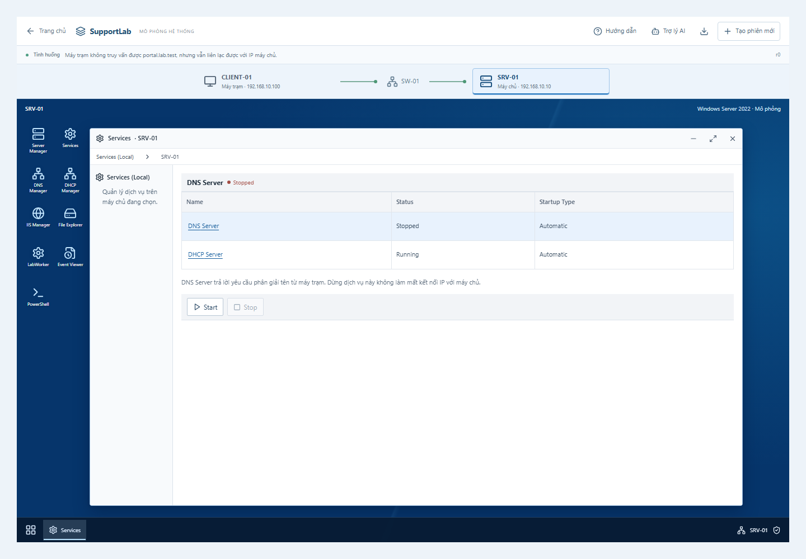
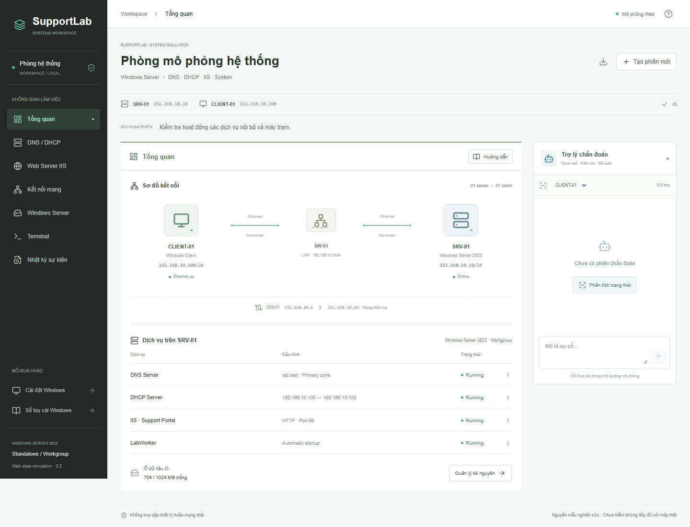
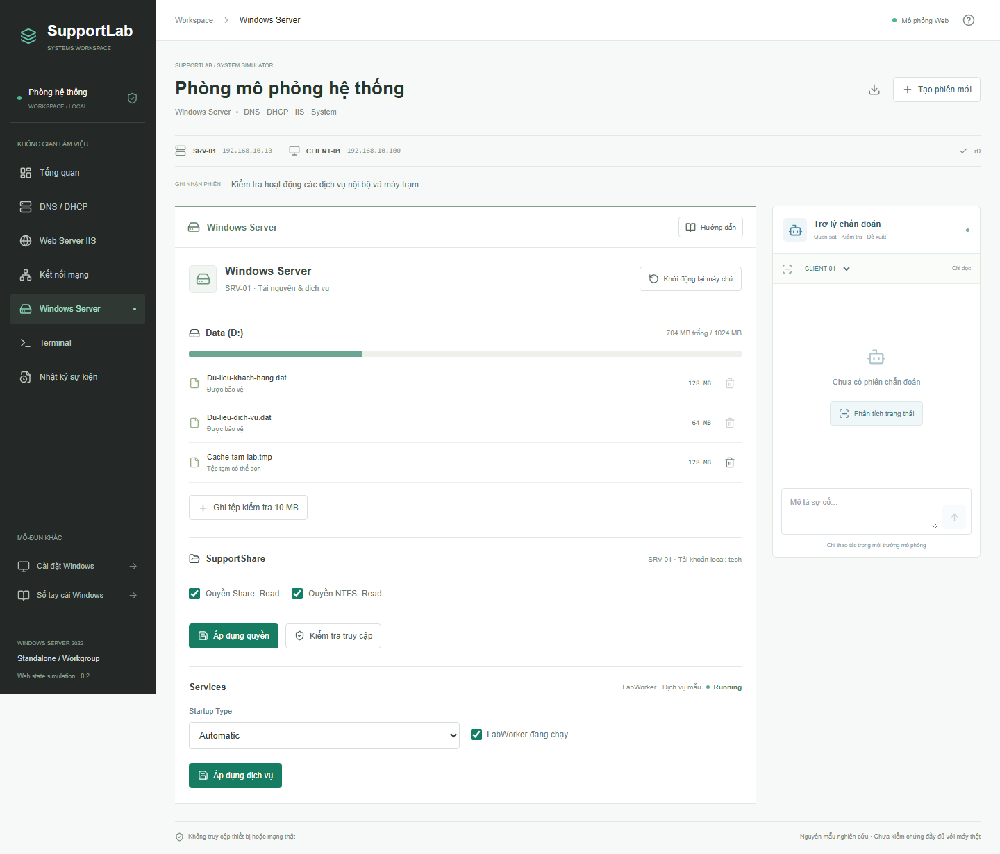

# SupportLab · Mô phỏng hệ thống CNTT

Nền tảng Web mô phỏng cấu hình và xử lý sự cố hệ thống CNTT, tích hợp trợ lý AI tùy chọn. Bản mẫu 0.2 tổ chức lại màn hình chính thành phòng hệ thống **Windows Server**, theo bốn nhóm: DNS/DHCP, IIS, kết nối mạng và một số lỗi tài nguyên/dịch vụ.

Người dùng tự thay đổi cấu hình và quan sát kết quả trong cùng một mạng mô phỏng. Hướng dẫn là tùy chọn; ứng dụng không tổ chức bài trắc nghiệm, chấm điểm hay tự động sửa lỗi.

**Mới sử dụng?** Đọc [Giải thích phần mềm cho người mới](docs/giai-thich-phan-mem.md): ý nghĩa các màn hình, thuật ngữ và ví dụ xử lý lỗi DNS từng bước.

**Kiểm chứng khóa luận:** xem [bộ kiểm chứng](docs/kiem-chung/README.md) để đọc ma trận chấp nhận bốn nhóm, rubric đánh giá AI Agent và phiếu đối chiếu Windows Server/Client.

Trang chủ **`/`** dùng để chọn tình huống mô phỏng. Phòng hệ thống tại **`/system`**. Mô-đun cài Windows trước đây được giữ tại **`/pc`**, sổ tay tại **`/handbook`**.

**Desktop Windows mô phỏng:** trang chủ cho chọn bốn nhóm, tình huống và **Có hướng dẫn** hoặc **Tự khám phá**. Mỗi phiên mở sơ đồ CLIENT-01 — SW-01 — SRV-01, desktop từng máy, cửa sổ và thanh tác vụ riêng. Server Manager có menu Tools dẫn tới DNS, DHCP, Services, IIS, Event Viewer và PowerShell; thay đổi trên SRV-01 làm kết quả kiểm tra từ CLIENT-01 thay đổi theo. Các cửa sổ dùng chung trạng thái với trợ lý AI. Xem [hướng dẫn sử dụng desktop](docs/giao-dien-desktop-mo-phong.md).





> Đây là mô phỏng bằng trạng thái phần mềm, không phải máy ảo chạy Windows/Windows Server thật. Các thao tác không thay đổi BIOS, ổ đĩa, USB hoặc mạng của máy đang mở trình duyệt. Hành vi mới chưa được kiểm chứng đầy đủ trên Windows Server thật.

## Phòng hệ thống Windows Server

| Nhóm | Chức năng nguyên mẫu đã triển khai |
| --- | --- |
| DNS / DHCP | Thêm role, bật/dừng dịch vụ, lưu một bản ghi A, cấu hình scope/option, bật DHCP trên client và gia hạn lease. |
| Web Server IIS | Thêm role, đổi cổng binding, bật/dừng website và application pool, kiểm tra HTTP từ máy trạm. |
| Kết nối mạng | Thay IPv4/prefix/gateway/DNS, nối/ngắt link, bật/tắt interface; chẩn đoán cùng LAN và qua gateway. |
| Windows Server | Ổ dữ liệu đầy, dọn tệp tạm có xác nhận, bảo vệ dữ liệu, quyền đọc Share/NTFS cho tài khoản local mẫu và Startup Type của LabWorker qua reboot. |

Mạng mới gồm SRV-01 `192.168.10.10/24`, CLIENT-01, gateway `192.168.10.1` và đích kiểm tra khác mạng `192.168.20.10`. Tên website là `portal.lab.test`. Đây là địa chỉ trong mô hình, không phải các phép dò mạng thật.

**Tạo phiên mới** cung cấp 18 trạng thái ban đầu đã có handler hoạt động, gồm máy chủ mới, trạng thái bình thường và các sự cố. Danh mục trong [kế hoạch chỉnh sửa](docs/ke-hoach-chinh-sua/README.md) có 22 ca ứng viên; không có nghĩa tất cả ca và tiêu chí nghiên cứu đã hoàn thành.

Phiên hệ thống dùng trạng thái chính trên máy chủ ứng dụng, có revision để từ chối thao tác dựa trên dữ liệu cũ. Zustand phản chiếu trạng thái và quản lý giao diện. Phiên nằm trong bộ nhớ một tiến trình, hết hạn sau 2 giờ không hoạt động, tối đa 200 phiên; không dùng cho triển khai nhiều instance. Tải lại trang tạo phiên mới. Có thể xuất JSON để tham khảo, **chưa có nhập lại hoặc tài khoản/lưu bền vững**.

Terminal chỉ đọc trong mô hình hỗ trợ `ipconfig`, `ping`, `nslookup`, `curl`, `Get-Service`, `Get-DhcpServerv4OptionValue -ScopeId 192.168.10.0`, `Get-Volume`, `Get-WinEvent`, `Get-SmbShareAccess`, `icacls` và `Test-Share` với tập tham số giới hạn. Nhập `help` để xem danh sách; thay đổi cấu hình qua các bảng điều khiển. `Get-Volume` chỉ cho biết thông tin và dung lượng ổ, không liệt kê tệp hoặc xác định tệp an toàn để xóa.

### Luồng truy vấn DNS trực quan

Khi bạn tự chạy `nslookup` trong Terminal, dải quan sát DNS phía trên công cụ biểu diễn một lượt yêu cầu, chờ và phản hồi theo kết quả engine. Nó ghi lại thiết bị/IP nguồn, DNS đích, tên truy vấn, kết quả và revision; không suy từ timeout rằng dịch vụ chắc chắn bị dừng. Bản ghi trả sai IP vẫn là **có phản hồi DNS**, khác với NXDOMAIN hoặc không nhận được phản hồi. Truy vấn local trên server và DNS ngoài mô hình không được vẽ thành một lượt trao đổi LAN thành công.

Thử nhanh: mở [tình huống DNS](http://127.0.0.1:3000/system?preset=dns-stopped&guide=dns), chạy `ping 192.168.10.10` rồi `nslookup portal.lab.test` trên CLIENT-01, quan sát timeout; kiểm tra dịch vụ và tự sửa theo hướng dẫn, rồi tra DNS lại để thấy phản hồi. Nút phát lại/tạm dừng chỉ điều khiển hình minh họa đã ghi nhận, không chạy thêm lệnh hoặc tự sửa cấu hình. Khi trạng thái thay đổi, quan sát cũ được đánh dấu và dừng phát; cần chạy lại lệnh để có kết quả mới. Chế độ giảm chuyển động hiển thị ngay khung kết quả tĩnh.

Đây là hình minh họa theo trạng thái mô phỏng, **không phải packet capture, mạng thật hoặc phép đo thời gian**. Hiện mới có luồng DNS; hiệu ứng DHCP DORA và HTTP chưa triển khai. Xem [cách đọc và thử luồng DNS](docs/giai-thich-phan-mem.md#luồng-truy-vấn-dns-trực-quan).

Trợ lý mới có công cụ đọc phiên, chẩn đoán và tìm kiếm ghi chú kỹ thuật có nguồn Microsoft Learn. Khi chưa cấu hình AI, phản hồi được gắn nhãn **Cục bộ · không dùng AI**. Khi bật API, Agent dùng vòng gọi công cụ chỉ đọc; không nhận ID preset/đáp án tình huống và không tự sửa cấu hình. Nếu API lỗi sẽ chuyển sang cục bộ có thông báo rõ, không coi là kết quả model.

**Giới hạn:** chưa có AD DS, domain, DHCP nhiều máy, toàn bộ DNS zone/cache/forwarder, cấu hình IIS tổng quát, HTTPS, ACL kế thừa/Deny hoặc đầy đủ Services/Event Viewer. Các quy tắc kết nối, lease, HTTP, ổ dữ liệu và quyền được giản lược. Còn cần đối chiếu lab thật, đánh giá model thật và thử nghiệm người dùng trước khi kết luận đáp ứng đầy đủ yêu cầu khóa luận.



Trong trợ lý tại `/system`, nút **Kiểm tra lại DNS / website** chạy năm phép kiểm trên cùng cấu hình hiện tại: ping, dịch vụ DNS, phân giải tên, HTTP theo tên và HTTP qua IP. Phần nhận định phân biệt lỗi mạng, dịch vụ DNS, phân giải, IIS và lỗi kết hợp; kết quả cũ được đánh dấu khi cấu hình thay đổi. Nút **Xuất hồ sơ phiên** tải JSON gồm thao tác trước/sau, chẩn đoán và input/output công cụ của trợ lý; phân biệt quy trình kiểm tra cố định, công cụ model tự chọn và fallback cục bộ. Hồ sơ lưu tạm trong RAM, có giới hạn dung lượng và dấu hiệu lược bỏ; chưa có chức năng nhập lại. Xem [cách thử và lưu hồ sơ](docs/giai-thich-phan-mem.md#kiểm-tra-lại-sau-khi-sửa-dns-hoặc-website).

Ngày 05/11/2026, đã đối chiếu ba giai đoạn DNS với log của hai VM đã đo ngày 02/11: năm hành vi DNS/IIS cùng LAN đều khớp trong phạm vi ca D02. Chạy `npm run compare:dns` để kiểm hash bằng chứng cục bộ và so sánh mã mô phỏng hiện tại; lệnh không khởi động VM hoặc gọi AI. Xem [báo cáo nâng cấp và ảnh thử trên Web](docs/bao-cao-nang-cap-dns-2026-11-05.md). Kết quả chưa xác nhận toàn bộ pilot, mọi hành vi Windows hoặc chất lượng model thật.

## Mô-đun cài Windows được giữ lại

| Thành phần | Nội dung |
| --- | --- |
| Máy tính mô phỏng | Máy có Windows hoặc máy trống; bật, tắt, khởi động lại và tạo phiên mới. |
| BIOS / UEFI | Secure Boot, TPM, UEFI/Legacy, Intel VMD và thứ tự khởi động. |
| Menu boot | Chọn USB hoặc SSD cho một lần khởi động, không đổi thứ tự boot đã lưu. |
| Cài Windows | Nhận SSD theo trạng thái bộ điều khiển, chuẩn bị GPT/phân vùng và cài Windows mô phỏng. |
| Driver lưu trữ | Mô phỏng tải, giải nén, chép USB, duyệt thư mục và nạp driver tương thích. |
| Mạng và CMD | Chỉnh IP, gateway, DNS, DHCP; kiểm tra bằng các lệnh mô phỏng. |
| Hướng dẫn làm cùng | Gợi ý theo trạng thái hiện tại, chỉ vị trí thao tác và giải thích lý do. |
| Sổ tay kỹ thuật | Tham khảo cài Windows cho Dell, ASUS, HP và PC tự ráp. |
| Trợ lý kỹ thuật | Giải thích cục bộ hoặc kết nối OpenAI khi được cấu hình. |

## Công nghệ

Next.js 15 (App Router), React 19, TypeScript, Tailwind CSS, Lucide React, Zustand, Zod, XState và Motion for React. Kiểm thử bằng Node.js Test Runner qua `tsx` và Playwright.

## Cài đặt và chạy

Yêu cầu **Node.js 20.9 trở lên**, npm và Git nếu tải bằng lệnh clone.

```sh
git clone https://github.com/phanduyan134-coder/MoPhongITSUPPORT.git
cd MoPhongITSUPPORT
npm install
npm run dev
```

Mở địa chỉ Local được in trong terminal, thường là **http://127.0.0.1:3000**. Next.js sẽ chọn cổng khác nếu cổng đó đã được dùng.

`npm install` cài thư viện; những lần chạy sau thường chỉ cần `npm run dev`. Không cần API key để sử dụng mô phỏng và hướng dẫn cục bộ.

Chạy bản tối ưu:

```sh
npm run build
npm start
```

Môi trường phát triển dùng `.next-dev`, bản build dùng `.next`, kiểm thử trình duyệt dùng `.next-e2e` để tránh ghi đè kết quả.

## Hình ảnh giao diện

Ảnh chụp trực tiếp từ bản mẫu, không phải giao diện BIOS thật của từng model.

Các ảnh BIOS, driver, mạng và sổ tay dưới đây thuộc mô-đun **`/pc`**, không phải giao diện Windows Server mới.

### BIOS / UEFI

Cấu hình firmware tổng quát và quan sát ảnh hưởng tới khởi động, nhận SSD và cài đặt.


### Chuẩn bị driver

Hướng dẫn máy thật được tách biệt với các gói driver mẫu trong mô phỏng.


### Cấu hình mạng

Chỉnh IPv4 và dịch vụ DHCP trên router, sau đó kiểm tra bằng CMD mô phỏng.


### Sổ tay cài Windows

Chọn nhóm thiết bị và mục tiêu cài đặt để xem quy trình cùng cảnh báo.


## Sử dụng mô-đun cài Windows (`/pc`)

### Cài Windows có hướng dẫn

1. Chọn **Tạo phiên mới**, chọn máy trống và xác nhận.
2. Bật **Hướng dẫn**, chọn **Cài Windows từ USB**.
3. Thực hiện gợi ý: cắm USB, vào BIOS, cấu hình firmware và boot USB.
4. Nếu VMD khiến bộ cài chưa nhận SSD, chuẩn bị và nạp driver mẫu.
5. Xác nhận chuẩn bị GPT/phân vùng khi muốn xóa ổ mô phỏng, rồi cài Windows.
6. Boot từ SSD và rút USB sau khi Windows mô phỏng đã chạy.

Hướng dẫn đọc trạng thái máy, không tiến bước bằng đánh dấu thủ công. Thay đổi cấu hình sẽ cập nhật gợi ý. **Chỉ vị trí thao tác** chỉ mở đúng màn hình và đưa tiêu điểm tới nút cần dùng; **Vì sao cần bước này?** giải thích cơ sở kỹ thuật.

Bật hướng dẫn không tự xóa ổ hay tạo phiên mới. Máy đã có Windows cần lựa chọn cài lại rõ ràng; Windows có sẵn không được coi là kết quả của lần cài theo hướng dẫn. Chuẩn bị phân vùng vẫn cần xác nhận riêng.

### Chuẩn bị và nạp driver

Trên máy thật, nếu cần driver lưu trữ, dùng máy đang hoạt động để tra **đúng model, bộ điều khiển, Windows và kiến trúc**, tải từ trang hãng, giải nén theo tài liệu rồi chép vào USB **sau khi đã tạo USB boot**. Không format hoặc tạo lại USB sau khi chép. USB chứa tệp để bộ cài đọc, không phải thiết bị được cài driver.

**Không phải máy nào cũng cần nạp driver để nhận SSD.** Nếu BIOS nhận ổ nhưng Windows Setup chưa nhận, kiểm tra gói lưu trữ phù hợp. Nếu BIOS cũng không nhận, cần kiểm tra thêm kết nối, phần cứng hoặc cấu hình. Không đổi RAID/VMD/AHCI tùy tiện trên máy có Windows hay RAID. AMD/ARM không dùng mặc định gói Intel VMD x64.

Trong mô phỏng Intel VMD x64:

1. Mở **Chuẩn bị driver**, chọn **Gói Intel VMD x64**.
2. Chọn **Tải gói mô phỏng**, **Giải nén gói**, kết nối USB rồi **Chép vào USB**.
3. Trong Windows Setup khi chưa thấy SSD, chọn **Nạp driver Intel VMD → Browse**.
4. Chọn `E:\Drivers\Storage`, xác nhận thư mục, chọn **Intel VMD Controller (x64)** rồi **Nạp driver**.

Gói Ethernet không tương thích bộ điều khiển lưu trữ. Nạp driver chỉ làm SSD xuất hiện, không format ổ. Tệp trên USB còn sau khi rút USB; driver tạm trong Setup cần nạp lại khi khởi động lại bộ cài. Driver của Windows đã cài được theo dõi riêng.

Tên tệp như `vmd-controller.inf`, ký tự ổ `E:` và đường dẫn chỉ là ví dụ. Ứng dụng không tải driver thật, giải nén thật, đọc USB, phân tích INF, kiểm tra Hardware ID/chữ ký hoặc thực thi driver. Bộ duyệt chỉ tìm trong thư mục chọn, không quét thư mục con. Liên kết hãng là cổng tra cứu, không tự tìm hay xác minh gói từng model. EXE cần cách trích xuất do hãng hướng dẫn, không có lệnh chung cho mọi gói. Driver Wi-Fi/LAN sau cài là các gói riêng.

### Kiểm tra và xử lý mạng

Trong **Hướng dẫn**, chọn **Kiểm tra và xử lý mạng**. Hướng dẫn bắt đầu từ `ipconfig /all`, rồi gợi ý kiểm tra theo trạng thái IP, gateway, DNS hoặc DHCP.

```text
ipconfig /all
ping 192.168.1.1
ping 192.168.1.10
ping 8.8.8.8
nslookup example.com
ipconfig /renew
ipconfig /flushdns
```

Nhập `help` trong CMD mô phỏng để xem các lệnh hỗ trợ. Đây không phải lệnh hệ thống hoặc lưu lượng mạng thật; kết nối IP và phân giải DNS được kiểm tra riêng.

Thay đổi trường mạng chỉ là bản nháp tới khi chọn **Áp dụng cấu hình**. Bật lại DHCP không tự gia hạn IP. Khi cấu hình, DHCP hoặc nguồn thay đổi và sau khi khởi động lại, quan sát chẩn đoán cũ bị vô hiệu hóa; lịch sử CMD vẫn giữ để tham khảo. Máy chưa có Windows không tạo kết quả kiểm tra mạng giả. Chuyển hướng dẫn không làm mất cấu hình máy hay lựa chọn cài lại Windows.

### Sổ tay và hồ sơ ASUS

Mở **Sổ tay cài Windows** hoặc `/handbook`: nhận diện thiết bị, sao lưu, BitLocker nếu có mã hóa, chuẩn bị USB, boot, driver, phân vùng và bàn giao. Có nhánh cài mới và cài lại từ Windows để giữ tệp/ứng dụng khi được hỗ trợ. Có thể in toàn bộ quy trình; dấu kiểm là ghi chú cá nhân, không chứng nhận đã thao tác đúng.

Danh mục ASUS ban đầu có X515EA, FA506NC, X1504VA, UX3405MA, D500ME và PRIME B760M-A WIFI D4, phân biệt laptop, desktop nguyên bộ và mainboard. Model không khớp dùng hướng dẫn tổng quát. Không suy ra VMD từ tên model; CPU được chọn thủ công và đặt lại khi đổi model, không tự phát hiện phần cứng.

Các hồ sơ hiện đều ở mức **tổng quát (`general`)**, chưa kiểm chứng cài đặt trên máy thật. Mở được trang tài liệu không đồng nghĩa quy trình đã được xác minh. Nguồn và mức kiểm chứng ghi tại `src/lib/asus-profiles.ts`; nâng lên `documented` hoặc `tested` cần bằng chứng đúng firmware, bản Windows, ngày và phạm vi.

<details>
<summary>Ghi chú đối chiếu nguồn</summary>

- Ngày 19/10/2026 đã tham khảo hướng dẫn vào BIOS ASUS, trang tải Windows 11 của Microsoft và ASUS FAQ 1044458 về driver theo nền tảng.
- Trang tài liệu X515EA và FA506NC được mở để xác nhận danh tính, chưa kiểm chứng firmware, driver hoặc cài đặt. Các liên kết model khác được đánh dấu chưa kiểm tra.
- Bài Dell trả HTTP 403, bài HP hết thời gian chờ và ASUS FAQ boot 1030858 trả 404. Phím tắt theo hãng là thông lệ tham khảo, không phải xác minh cho từng model.
- Danh mục không bao phủ mọi model ASUS. Kiểm tra tài liệu đúng model, revision và firmware trước khi áp dụng trên thiết bị thật.

</details>

## Trợ lý AI tùy chọn

Mặc định ứng dụng dùng giải thích cục bộ không cần API key. Để kết nối OpenAI, tạo `.env.local` dựa trên `.env.example`:

```dotenv
SUPPORTLAB_AI_ENABLED=true
OPENAI_API_KEY=
OPENAI_MODEL=
OPENAI_BASE_URL=https://api.openai.com/v1
```

Điền khóa riêng và model hỗ trợ Responses API mà tài khoản được phép dùng, rồi khởi động lại máy chủ. Ứng dụng không tự chọn model. **Không commit `.env.local`, API key hoặc nhập mật khẩu/khóa khôi phục BitLocker vào trò chuyện.**

Trợ lý cũ tại `/pc` chỉ đọc snapshot máy mô phỏng và nhật ký/kết quả CMD. Nó giới hạn 4 yêu cầu model, 30 giây/câu trả lời và 30 yêu cầu/phút trong một tiến trình. Trợ lý mới tại `/` đọc phiên chính trên máy chủ, có công cụ chẩn đoán/truy xuất, giới hạn số vòng công cụ, 25 giây và hạn mức yêu cầu. Cả hai không thay đổi máy hay thực thi lệnh hệ thống; phản hồi cục bộ và OpenAI có nhãn riêng. Khóa giữ ở máy chủ.

Tham khảo: [Tài liệu Responses API chính thức](https://developers.openai.com/api/reference/resources/responses/methods/create/).

## Kiểm thử

```sh
npm test
npm run typecheck
npm run build
npx playwright install chromium
npm run test:e2e
```

Playwright dùng cổng `3100`, thư mục build riêng và trợ lý cục bộ. Ảnh kiểm thử ở `output/screenshots` không đẩy lên Git; ảnh giới thiệu ở `docs/images` được commit để GitHub hiển thị trong README.

## Cấu trúc chính

```text
src/app/             Trang ứng dụng, sổ tay và API trợ lý
src/components/      Giao diện máy tính, công cụ và hướng dẫn
src/lib/             Trạng thái, logic mô phỏng và nội dung tham khảo
src/lib/system-*     Engine Windows Server, phiên, store và kho tri thức
src/lib/system-guide-machine.ts State machine XState cho hướng dẫn thao tác DNS
src/lib/scenario-guide-machine.ts Hướng dẫn DHCP, IIS, gateway và ổ đĩa đầy
src/app/api/simulation/ API tạo phiên, thao tác và chẩn đoán hệ thống
src/app/api/system-agent/ API trợ lý chẩn đoán cho phòng hệ thống
tests/               Kiểm thử logic và trạng thái
tests/e2e/           Kiểm thử trình duyệt
docs/images/         Ảnh giới thiệu trong README
.env.example         Mẫu cấu hình không chứa khóa thật
```

Trong mô-đun `/pc`, firmware, ổ đĩa, mạng, USB và nguồn dùng chung qua Zustand trong `src/lib/store.ts`; logic khởi động, mạng và CMD ở `src/lib/engine.ts`. Phiên này chưa lưu bền vững: tạo phiên mới hoặc tải lại trang sẽ xóa dữ liệu mô phỏng, nhật ký và trò chuyện. Mạng cố định `192.168.1.0/24` của `/pc` là mô hình cũ, độc lập với mạng `192.168.10.0/24` của phòng hệ thống.

Cả năm tình huống trên trang chủ đều có dẫn thao tác: DNS, DHCP, IIS, gateway và ổ đĩa đầy. XState chuyển bước theo bằng chứng người dùng tự tạo; giao diện focus điều khiển, giải thích lý do và kết quả cần quan sát. Người dùng vẫn tự chạy lệnh, áp dụng cấu hình và xác nhận xóa tệp; Motion chỉ biểu diễn chuyển trạng thái. Mỗi luồng hiện áp dụng cho tình huống mẫu tương ứng, không bao quát mọi lỗi trong nhóm. Chi tiết tại [06-huong-dan-tuong-tac-xstate-motion.md](docs/ke-hoach-chinh-sua/06-huong-dan-tuong-tac-xstate-motion.md).

- **DNS, 6 bước:** ping → tra tên → `Get-Service DNS` trên SRV-01 → chỉ bật DNS nếu đã xác nhận `Stopped` → tra lại tên → kiểm tra HTTP. Timeout không đủ để kết luận dịch vụ bị dừng; nếu dịch vụ đã `Running`, bỏ qua thao tác bật và kiểm tra lại từ máy trạm.
- **Gateway, 7 bước:** xem IP và nguồn DHCP → ping LAN → ping khác mạng → đối chiếu option DHCP trên SRV-01 → giữ DHCP và gia hạn → đọc lại IP/gateway/DNS → ping lại khác mạng. Mẫu này mô phỏng máy trạm còn giữ gateway cũ trong khi option máy chủ đã đúng, không hướng dẫn đổi sang IP tĩnh trong dải DHCP.
- **Ổ đĩa:** xem dung lượng bằng `Get-Volume`, sau đó kiểm tra danh sách tệp ở bảng Windows Server. `Cache-tam-lab.tmp` được tình huống cho phép xóa; không suy từ đuôi `.tmp` rằng mọi tệp tương tự đều an toàn. Cờ bảo vệ dữ liệu chỉ là cơ chế an toàn của mô phỏng, không phải cơ chế bảo vệ tự động của Windows.

**Chưa đối chiếu với lab Windows Server thật.** Kiểm thử tự động xác nhận hành vi của mã và giao diện, không chứng minh mô phỏng chính xác với hệ điều hành thật. Kế hoạch đối chiếu DNS/DHCP, gateway và ổ đĩa cùng cách ghi nhận sai khác nằm trong tài liệu hướng dẫn tương tác ở trên.

## Phạm vi và giới hạn

- Chưa phải trình giả lập Windows/BIOS đầy đủ, hypervisor hoặc bộ cài thật. Cài Windows là chuyển trạng thái tức thì, chưa mô phỏng sao chép tệp và OOBE.
- BIOS tổng quát không tái hiện chính xác từng model. Sổ tay không thay thế tài liệu hãng hay kiểm chứng trên máy thật.
- Mạng cố định `192.168.1.0/24`: router `.1`, máy chủ nội bộ `.10`, IP thuê DHCP `.50`. DNS biết trước: `.1`, `1.1.1.1`, `8.8.8.8`; `example.com` và `uit.edu.vn` có bản ghi minh họa cố định. Chưa mô phỏng cáp hoặc Wi-Fi vật lý.
- Chuẩn bị GPT tự động xóa toàn bộ phân vùng mô phỏng; chưa có trình chia ổ tùy ý. Schema chỉ có FAT32/NTFS nên MSR dùng NTFS giữ chỗ nhưng không hiển thị filesystem; MSR thật không được format.
- Chưa mô phỏng cài Office, lắp ráp/sửa phần cứng, máy in hoặc camera.
- Chưa có tài khoản, lưu phiên bền vững hoặc hạn mức phân tán. Snapshot trợ lý `/pc` vẫn do trình duyệt gửi; phòng hệ thống mới dùng phiên chính trên máy chủ. Cần kiểm soát truy cập và tài nguyên trước khi triển khai công khai. Kiểm thử tích hợp Agent mới dùng mock nhà cung cấp; chưa đánh giá model bên ngoài thực tế.

Word/Excel phục vụ khóa luận, thư viện cài đặt, tệp bí mật và kết quả build được loại khỏi repository bằng `.gitignore`.
