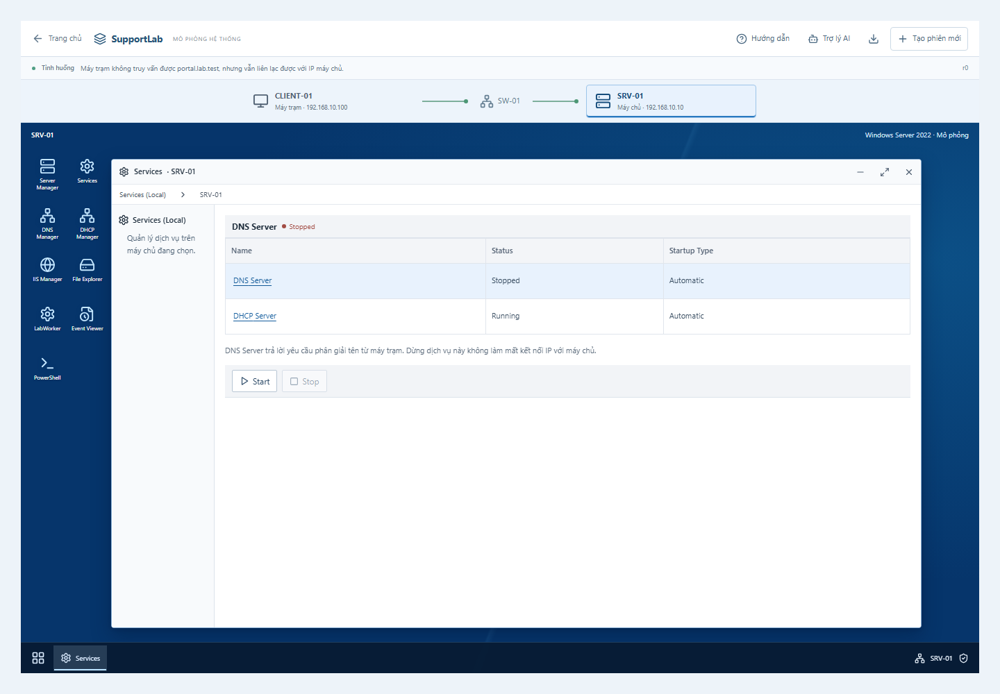
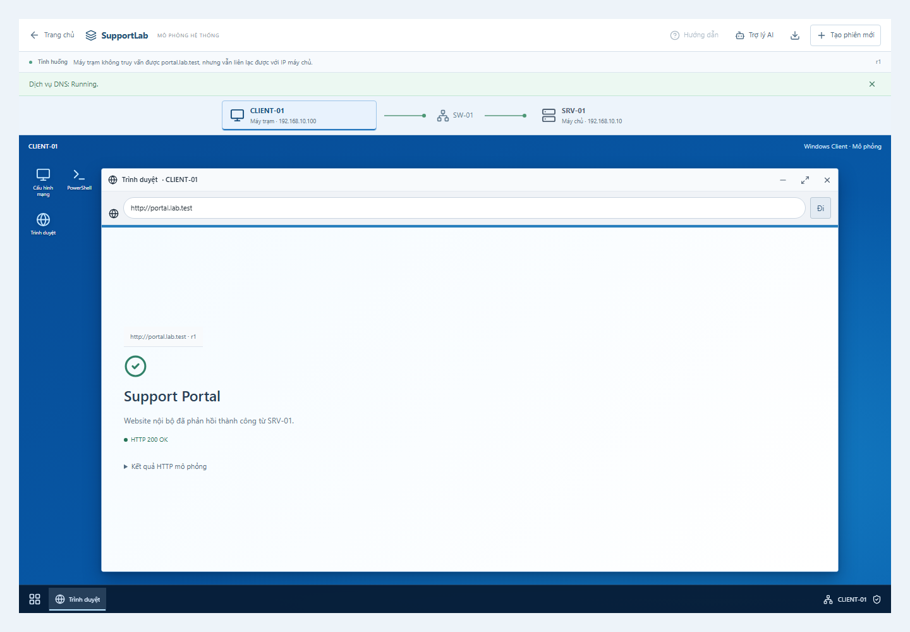

# Giao diện desktop mô phỏng Windows — 05/11/2026

Đã chuyển luồng chính sang desktop immersive mô phỏng Windows. Trang chủ chọn bốn nhóm và tình huống; sau đó người học thao tác trên **CLIENT-01 — SW-01 — SRV-01** cùng trợ lý AI trong một không gian làm việc. Công cụ classic vẫn giữ lại để đối chiếu.

## Mở để xem

Chạy `npm run dev`, mở trang chủ, chọn nhóm **DNS / DHCP** và tình huống, sau đó chọn **Có hướng dẫn**. Đường dẫn mở trực tiếp:

```text
/system?preset=dns-stopped&workspace=desktop&guide=dns
```

Xem [hướng dẫn sử dụng từng cửa sổ](giao-dien-desktop-mo-phong.md).

## Những gì đã làm

| Khu vực | Hành vi |
| --- | --- |
| Sơ đồ | Chọn máy chủ hoặc máy trạm để chuyển desktop; hiển thị IP đang áp dụng và kết nối Ethernet. |
| Desktop | Biểu tượng ứng dụng, Start menu, thanh tác vụ; thu nhỏ, khôi phục, phóng to và đóng cửa sổ. Bố cục hẹp dùng lưới/dải biểu tượng responsive, không dùng scrollbar native gây lệch giao diện. |
| Máy chủ | Server Manager thêm role và menu Tools mở DNS/DHCP/Services/IIS/Event Viewer/PowerShell; DNS Manager sửa bản ghi A `portal.lab.test`. |
| Máy trạm | Cấu hình IPv4/DNS/DHCP, trạng thái Ethernet; PowerShell riêng CLIENT-01; trình duyệt kiểm tra HTTP bằng tên hoặc IP. |
| Hướng dẫn | Mở đúng máy/cửa sổ, focus và giải thích theo sáu bước DNS hoặc quy trình DHCP/IIS/Gateway/ổ đĩa; người dùng tự thao tác. |
| Kết quả | Có revision; thay đổi cấu hình làm kết quả trước đó được đánh dấu cũ, cần kiểm tra lại. |
| Phiên | Mỗi máy giữ cửa sổ và nội dung nháp riêng; chuyển qua công cụ cũ rồi quay lại vẫn giữ desktop. Tạo phiên mới đặt lại toàn bộ. |

## Tính thực chất của mô phỏng

Desktop gọi cùng API và engine trạng thái đang dùng, không tạo bộ kết quả riêng để minh họa. Services Start/Stop cập nhật trạng thái DNS; DNS Manager Apply thay bản ghi; lệnh và trình duyệt đọc cấu hình hiện tại của cùng phiên. Mở cửa sổ, chuyển máy và nhập nháp không thay đổi cấu hình.

Luồng đã thử: DNS bị dừng → máy trạm truy cập theo tên thất bại nhưng HTTP qua IP vẫn hoạt động → tự Start DNS trên máy chủ → quay về máy trạm kiểm tra lại theo tên thành công. Sửa bản ghi A thành `.99` làm truy vấn trả về `.99` và truy cập website thất bại tại đích đó. Hệ thống không tự coi dịch vụ Running là đã sửa xong mọi lỗi.

AI Agent tiếp tục đọc trạng thái, công cụ và nhật ký phiên hiện có. Đợt nâng cấp này tập trung giao diện; không bổ sung hoặc đánh giá model AI mới.

## Ảnh chụp Web

Ảnh chụp bằng trình duyệt từ tình huống DNS, không phải ảnh dựng hoặc ảnh Windows chạy trong VM.





## Kiểm tra đã thực hiện

| Kiểm tra | Kết quả |
| --- | --- |
| `npm test` | 194/194 kiểm thử logic và API đạt. |
| `npx playwright test tests/e2e/immersive-os.spec.ts tests/e2e/system-launch.spec.ts` | Các luồng immersive, chọn nhóm, menu Tools, DNS tree, drawer hướng dẫn và session replacement đạt. |
| `npx playwright test tests/e2e/device-desktop.spec.ts --reporter=line` | 10/10 đạt sau tinh chỉnh cuối: bổ sung luồng hướng dẫn đầy đủ trên mobile, cuộn tới vùng focus và đặt giải thích ngay cạnh thao tác. |
| `npm run typecheck`, `npm run build` | Đạt; bản production biên dịch thành công. |
| Xem ảnh thực tế | Đã xem Services, trình duyệt, hướng dẫn trên desktop và màn hình hẹp 390 px. |

Các kiểm thử xác nhận tính năng và hồi quy phần mềm, chưa phải thực nghiệm đánh giá hiệu quả học tập hoặc chất lượng model AI.

## Phạm vi hiện tại

Desktop có cửa sổ mô phỏng cho DNS, DHCP, IIS, File Explorer, LabWorker, Event Viewer, Network Properties, PowerShell và trình duyệt. Giao diện tái hiện các thao tác được hỗ trợ, không chạy toàn bộ Windows và chưa mô phỏng mọi menu, driver, hệ thống tệp hoặc phần cứng thật.

Việc kiểm chứng hành vi engine với lab tham chiếu và đánh giá AI vẫn theo kế hoạch nghiên cứu trước đó. Không khởi động hay thay đổi VM hoặc mạng thật trong lần nâng cấp giao diện này.
