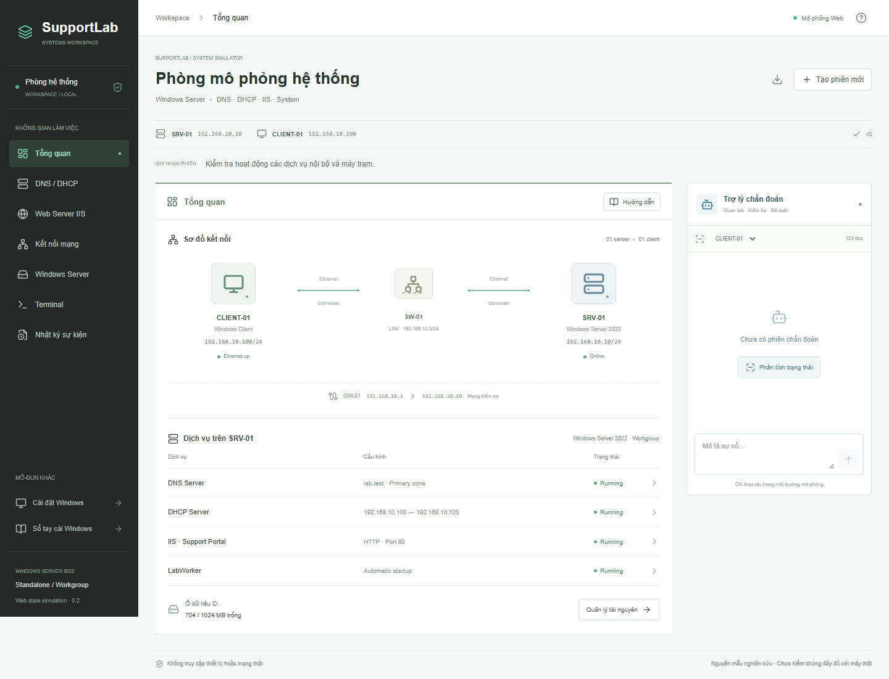
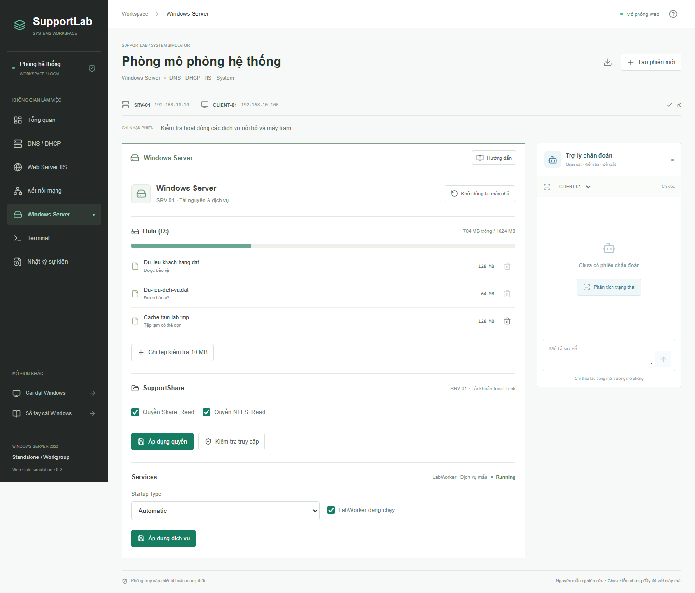

# Giải thích phần mềm SupportLab cho người mới

Tài liệu này dành cho bạn khi mới mở phần mềm và chưa rõ nên nhìn vào đâu, thao tác gì, hoặc tại sao lại có DNS, DHCP và Windows Server.

**Hiểu ngắn gọn:** SupportLab tạo ra một hệ thống máy tính nhỏ trong trình duyệt. Bạn có thể thay đổi cấu hình, làm hệ thống gặp lỗi, kiểm tra nguyên nhân rồi sửa và quan sát kết quả. Bạn không cần cài Windows Server thật để thử những thao tác được hỗ trợ.

**Giao diện desktop mới:** ở trang chủ, chọn **Mở desktop có hướng dẫn DNS** để thao tác trong cửa sổ Services, DNS Manager, PowerShell và trình duyệt của từng máy. Sơ đồ máy chủ–máy trạm vẫn ở phía trên. Xem [hướng dẫn desktop kèm ảnh](giao-dien-desktop-mo-phong.md).

> Đây là nguyên mẫu mô phỏng bằng trạng thái phần mềm, không phải Windows Server thật đang chạy trong trình duyệt. Mọi thao tác trong mô phỏng chỉ ảnh hưởng phiên mô phỏng, không sửa Windows, ổ đĩa hay mạng của máy bạn.

## 1. Phần mềm này dùng để làm gì?

Ví dụ một nhân viên báo: **"Máy em không vào được website nội bộ."**

Câu báo này chưa nói lên nguyên nhân. Có thể máy mất mạng, cấu hình DNS sai, dịch vụ DNS bị dừng hoặc website IIS không chạy. SupportLab cho bạn thử kiểm tra các khả năng này trong một mô hình đơn giản.

Quy trình sử dụng là:

**Quan sát hiện tượng → Kiểm tra → Xác định nguyên nhân → Thay đổi cấu hình → Kiểm tra lại.**

Bạn có thể tự khám phá hoặc bật hướng dẫn khi cần. Không có điểm số, bài trắc nghiệm hay yêu cầu phải bấm đúng một trình tự cố định. Các trạng thái lỗi có sẵn chỉ giúp bạn nhanh chóng tạo một hệ thống đang gặp sự cố để thử xử lý.

Phần mềm cũng có thể giúp bạn ôn lại cách suy luận khi xử lý sự cố. Tuy nhiên, quy trình trên thiết bị thật còn phụ thuộc cấu hình, phiên bản hệ điều hành và môi trường của khách hàng; không nên coi mô phỏng là hướng dẫn chính xác cho mọi máy.

## 2. Vì sao giao diện hiện tại khác phần cài Windows trước đây?

Theo góp ý của giảng viên, đề tài cần tập trung vào một số nhóm cấu hình và sự cố có thể mô phỏng, kiểm chứng và đánh giá được. Vì vậy, màn hình chính hiện chuyển sang **hệ thống Windows Server**, thay vì cố bao phủ mọi công việc IT Support.

| Khu vực | Nội dung | Đường dẫn khi chạy ở cổng 3000 |
| --- | --- | --- |
| Chọn mô phỏng | Chọn một trong năm tình huống lỗi có dẫn thao tác focus theo từng bước. | http://127.0.0.1:3000/ |
| Phòng hệ thống mới | DNS, DHCP, IIS, kết nối mạng và lỗi Windows Server cơ bản. Đây là phần đang ưu tiên cho khóa luận. | http://127.0.0.1:3000/system |
| Cài đặt Windows | Phần mô phỏng BIOS, USB, driver lưu trữ và cài Windows đã có trước đây. | http://127.0.0.1:3000/pc |
| Sổ tay cài Windows | Tài liệu tham khảo quy trình cài Windows theo nhóm thiết bị. | http://127.0.0.1:3000/handbook |

**Hai phòng mô phỏng độc lập:** thay đổi mạng trong phòng hệ thống không làm thay đổi mạng ở phần cài Windows. Nếu máy chủ ứng dụng chạy cổng khác, thay `3000` bằng cổng đó.

## 3. Bạn đang quản lý những thiết bị nào?



Hãy hình dung đây là mạng của một văn phòng nhỏ:

| Tên trên màn hình | Hiểu đơn giản | Vai trò trong mô hình |
| --- | --- | --- |
| **SRV-01** | Máy chủ của văn phòng. | Có IP `192.168.10.10`; cung cấp DNS, DHCP, website IIS và thư mục chia sẻ. |
| **CLIENT-01** | Máy của nhân viên. | Dùng dịch vụ của máy chủ. Ở trạng thái bình thường, IP là `192.168.10.100`. |
| **SW-01** | Switch nối các máy trong mạng LAN. | Thể hiện kết nối giữa máy trạm và máy chủ; chưa có giao diện cấu hình switch. |
| **GW-01** | Gateway, tức đường đi sang mạng khác. | Có IP `192.168.10.1`; giúp mô hình kiểm tra kết nối tới `192.168.20.10`. |

Địa chỉ `192.168.20.10` là **đích kiểm tra khác mạng trong mô phỏng**, không phải Internet thật. `portal.lab.test` là tên website nội bộ mẫu, không phải website công khai để mở bằng trình duyệt bên ngoài.

Khi dùng Terminal, bạn cần chọn đúng thiết bị: muốn biết nhân viên có truy cập được website không thì kiểm tra từ **CLIENT-01**; muốn xem dịch vụ máy chủ thì chọn **SRV-01**.

## 4. Các thuật ngữ cần biết trước

| Thuật ngữ | Nghĩa dễ hiểu | Ví dụ trong phần mềm |
| --- | --- | --- |
| IP | Địa chỉ của thiết bị trong mạng. | Máy chủ dùng `192.168.10.10`. |
| Prefix `/24` | Cách biểu diễn phần mạng của địa chỉ IP; tương ứng subnet mask `255.255.255.0`. | Trong mô hình này, `.10` và `.100` cùng mạng `192.168.10.0/24`. |
| Gateway | Thiết bị chuyển tiếp khi cần tới mạng khác. | Sai gateway có thể vẫn ping được máy chủ cùng LAN nhưng không tới được đích khác mạng. |
| DNS | Dịch vụ tra tên thành địa chỉ IP. | Tra `portal.lab.test` ra `192.168.10.10`. |
| DHCP | Dịch vụ tự cấp IP và các thông số mạng cho máy trạm. | Cấp IP, gateway và địa chỉ DNS cho CLIENT-01. |
| Role | Nhóm chức năng được cài thêm trên Windows Server. | Cài role DNS để máy chủ cung cấp dịch vụ DNS. |
| Service | Tiến trình dịch vụ có trạng thái chạy hoặc dừng. | Đã cài DNS nhưng dịch vụ DNS bị dừng thì vẫn có lỗi. |
| Scope | Dải địa chỉ mà DHCP được cấu hình để cấp. | Dải mặc định từ `192.168.10.100` đến `192.168.10.120`. |
| Lease | Địa chỉ DHCP cho máy trạm sử dụng trong một khoảng thời gian. | Máy trạm đang giữ địa chỉ `.100`; dừng DHCP không đồng nghĩa máy mất IP ngay. |
| IIS | Web Server của Microsoft, dùng để phục vụ website. | Cung cấp website `portal.lab.test`. |
| Application pool | Nhóm tiến trình phục vụ ứng dụng trong IIS. | Website có thể còn bật nhưng pool bị dừng, dẫn tới HTTP 503 trong mô hình. |
| Quyền Share / NTFS | Hai lớp quyền liên quan đến truy cập thư mục Windows qua mạng. | Trong mô hình đơn giản này, tài khoản `tech` cần Read ở cả hai lớp. |
| Startup Type | Cách dịch vụ được phép khởi động. | Automatic: tự chạy khi khởi động máy; Manual: cần bật khi sử dụng; Disabled: không cho khởi chạy. |
| Revision, ví dụ `r3` | Số phiên bản trạng thái sau thao tác. **Không phải điểm số.** | Kết quả đo tại `r2` có thể đã cũ khi cấu hình chuyển sang `r3`. |

## 5. Từng mục trên giao diện dùng để làm gì?

**Bốn nhóm chuyên môn dùng chung một hệ thống**, không phải bốn bài riêng. Menu có thêm các công cụ quan sát nên bạn sẽ thấy nhiều hơn bốn mục.

| Mục ở menu bên trái | Bạn có thể làm gì tại đây? |
| --- | --- |
| **Tổng quan** | Xem sơ đồ máy chủ, máy trạm, kết nối, trạng thái dịch vụ và dung lượng ổ dữ liệu. |
| **DNS / DHCP** | Cài role còn thiếu; bật/dừng dịch vụ; sửa bản ghi tên website; cấu hình dải cấp IP, gateway và DNS. |
| **Web Server IIS** | Cài IIS; chỉnh cổng HTTP; bật/dừng website và application pool; thử truy cập website từ máy trạm. |
| **Kết nối mạng** | Nối/ngắt cáp mô phỏng, bật/tắt bộ điều hợp; đặt IP tĩnh hoặc nhận DHCP; gia hạn DHCP. |
| **Windows Server** | Kiểm tra ổ D:, dọn tệp tạm, thử ghi tệp, chỉnh quyền đọc thư mục chia sẻ và dịch vụ mẫu LabWorker. |
| **Terminal** | Nhập các lệnh chẩn đoán được hỗ trợ để xem kết quả trên CLIENT-01 hoặc SRV-01. |
| **Nhật ký sự kiện** | Xem các thao tác đã diễn ra và revision tương ứng; đây không phải Event Viewer đầy đủ của Windows. |

Ví dụ về sự liên quan giữa các mục: IIS vẫn chạy nhưng DNS bị dừng thì máy trạm có thể không tìm được website bằng tên. Vì vậy, không nên chỉ nhìn vào một công tắc để kết luận toàn hệ thống đã hoạt động tốt.

### Những nút chung

- **Tạo phiên mới:** chọn trạng thái khởi đầu khác, như hệ thống bình thường, máy chủ mới hoặc một sự cố có sẵn. Xác nhận tạo phiên sẽ đặt lại cấu hình, kết quả kiểm tra và hội thoại hiện tại.
- **Ghi chú công cụ:** mở ghi chú tĩnh cho công cụ đang xem, khác với chế độ dẫn thao tác tương tác.
- **Chọn mô phỏng:** quay lại trang chủ. Mỗi lần chọn tình huống từ trang chủ sẽ mở phiên mới theo đúng trạng thái ban đầu, không giữ lỗi đã sửa ở phiên trước.
- **Biểu tượng tải xuống:** xuất trạng thái ra file JSON để xem hoặc lưu làm tài liệu tham khảo. Hiện chưa nhập file này trở lại phần mềm được.
- **Trợ lý chẩn đoán:** khu vực bên phải, dùng để hỏi về trạng thái và hướng kiểm tra. Trên màn hình nhỏ, có thể cần cuộn xuống để thấy.

### Dẫn thao tác có focus

Ở trang chủ, cả năm tình huống đều có nút **Bắt đầu có hướng dẫn**. Chế độ này điền sẵn lệnh và thiết bị cần kiểm tra, chuyển màn hình, focus và tô sáng điều khiển; không tự chạy lệnh hay tự sửa lỗi. Bạn vẫn tự bấm, nhập cấu hình, xác nhận hoặc chạy lệnh.

| Tình huống | Dẫn thao tác hiện có |
| --- | --- |
| **DNS: Không phân giải được tên nội bộ** | 6 bước: ping máy chủ → tra DNS → `Get-Service DNS` trên SRV-01 → bật DNS Server nếu đã xác nhận Stopped → tra lại DNS → kiểm tra HTTP. |
| **DHCP: Máy trạm chưa nhận địa chỉ** | Xem IP máy trạm → kiểm tra DHCPServer trên máy chủ → bật DHCP → gia hạn lease → xác minh IP → tra DNS. |
| **IIS: Website trả về HTTP 503** | Tra DNS → kiểm tra HTTP 503 → bật application pool và **Áp dụng IIS** → xác minh HTTP 200. |
| **Gateway: Truy cập LAN nhưng không đến mạng khác** | 7 bước: xem IP/nguồn DHCP → ping LAN → ping khác mạng → đối chiếu option DHCP trên SRV-01 → giữ DHCP và **Gia hạn DHCP** → xem lại IP/gateway/DNS → ping lại khác mạng. |
| **Ổ đĩa: Không ghi được dữ liệu** | Xem dung lượng trên máy chủ → kiểm tra danh sách tệp riêng, xác nhận xóa cache được tình huống cho phép → tự bấm ghi tệp kiểm tra 10 MB. Cơ chế bảo vệ dữ liệu của mô phỏng ngăn xóa hai tệp dữ liệu mẫu. |

Thanh tiến trình cho biết bước hiện tại. Khung giải thích nằm sát ô lệnh, công tắc hoặc nút cần dùng, nêu lý do kiểm tra và kết quả cần quan sát. Nếu chuyển sang màn hình khác, bấm **Đến thao tác hiện tại** để quay về đúng điều khiển. Nút **Dừng dẫn thao tác** kết thúc hướng dẫn mà không đổi cấu hình.

Hướng dẫn chỉ chuyển bước khi có kết quả phù hợp từ đúng thiết bị, thuộc phiên và revision hiện tại. Chẩn đoán trên máy trạm dùng **CLIENT-01**; xem dịch vụ DNS/DHCP, option DHCP hoặc dung lượng ổ đĩa dùng **SRV-01**. Kiểm tra nhầm thiết bị hoặc kết quả chưa phù hợp sẽ có phản hồi. Chỉ sửa ô nhập nhưng chưa **Áp dụng** không được coi là đã sửa hệ thống; hủy xác nhận xóa tệp cũng không được coi là đã dọn ổ.

Đây là năm luồng hướng dẫn cho **năm trạng thái lỗi mẫu ở trang chủ**, không phải hướng dẫn bao phủ mọi nguyên nhân lỗi DNS, DHCP, IIS, mạng hoặc Windows Server. Những trạng thái khác, như quyền Share/NTFS hoặc LabWorker, vẫn có thể mô phỏng nhưng chưa có đầy đủ focus dẫn thao tác.

**Chú ý cách lưu thao tác:** các form mạng, DHCP, IIS, quyền và dịch vụ LabWorker cần bấm nút **Áp dụng...** tương ứng. Sửa bản ghi DNS cần **Lưu bản ghi**. Riêng bật/tắt dịch vụ DNS/DHCP, cáp mạng và bộ điều hợp được áp dụng ngay khi đổi ô chọn.

### Luồng truy vấn DNS trực quan

Dải quan sát DNS nằm phía trên nội dung công cụ, tách khỏi lịch sử Terminal. Khi chưa có kết quả, bạn thấy trạng thái chờ tại **Tổng quan**, **DNS / DHCP** và **Terminal**. Nó không tự chạy mô phỏng chỉ vì bạn mở một tình huống.

Sau khi **bạn tự chạy lệnh `nslookup` hợp lệ**, phần mềm ghi lại nguồn truy vấn, địa chỉ DNS đích, tên cần tra, loại bản ghi A, kết quả và revision. Hình minh họa chạy một lượt yêu cầu → chờ → phản hồi hoặc timeout rồi dừng. Chuyển sang công cụ khác không làm mất quan sát đã ghi nhận.

| Kết quả | Nên hiểu như thế nào? |
| --- | --- |
| Có phản hồi và IP | DNS đã trả một bản ghi A; IP vẫn có thể sai. Ví dụ trả `.99` không có nghĩa website trên `.10` đã hoạt động. |
| NXDOMAIN | Có phản hồi DNS nhưng không có tên/bản ghi tương ứng trong mô hình. Khác với mất phản hồi. |
| Timeout | Chưa nhận được phản hồi DNS. Không đủ bằng chứng để khẳng định dịch vụ đang dừng. |
| Đường tới máy chủ không khả dụng | Engine biết kết nối hiện tại không tới được SRV-01; hình minh họa không cho yêu cầu đi xuyên qua link đã ngắt. |
| DNS ngoài mô hình | Chưa biết máy chủ DNS đó có nhận yêu cầu hay không; phần mềm không tạo một phản hồi giả. |
| Truy vấn local trên SRV-01 | Máy chủ hỏi chính nó, kể cả `127.0.0.1`; không thể hiện thành truy vấn phát đi từ CLIENT-01. |

**Cách thử nhanh:**

1. Mở [tình huống không phân giải được tên](http://127.0.0.1:3000/system?preset=dns-stopped&guide=dns), vào Terminal và chọn **CLIENT-01**. Tự chạy `ping 192.168.10.10` theo bước kiểm tra IP đầu tiên.
2. Tự chạy `nslookup portal.lab.test`. Xem hình minh họa không nhận được phản hồi cùng kết quả timeout của Terminal.
3. Dùng các nút có biểu tượng phát lại hoặc tạm dừng để xem lại lượt quan sát này. **Phát lại không chạy thêm lệnh** và không đổi trạng thái hệ thống.
4. Tiếp tục hướng dẫn: kiểm tra `Get-Service DNS` trên **SRV-01**, chỉ bật dịch vụ khi đã xác nhận `Stopped`. Quan sát DNS cũ được đánh dấu là cũ và dừng phát khi trạng thái thay đổi.
5. Quay lại **CLIENT-01**, tự chạy lại `nslookup portal.lab.test` để có quan sát mới. Có thể thử `nslookup missing.lab.test` để thấy NXDOMAIN, hoặc chọn **SRV-01** và chạy `nslookup portal.lab.test 127.0.0.1` để xem truy vấn local.

Lệnh khác như `ping` hoặc `Get-Service` giữ lại quan sát DNS gần nhất, không tạo một lượt DNS mới ở dải này. **Xóa lịch sử Terminal**, tạo/đặt lại phiên hoặc chọn phiên mới sẽ xóa quan sát. Nếu cấu hình đã đổi, không dùng hình cũ để kết luận trạng thái hiện tại; hãy kiểm tra lại. Người bật chế độ giảm chuyển động sẽ thấy ngay khung kết quả tĩnh thay cho hiệu ứng di chuyển.

Đây là minh họa từ dữ liệu engine, **không phải gói tin thật, Wireshark, thời gian chờ thực tế hoặc kết nối ra mạng máy bạn**. Hiện chỉ có luồng DNS; DHCP DORA và HTTP chưa có hiệu ứng trao đổi tương ứng. Không có thao tác sửa lỗi tự động.

## 6. Ví dụ đầu tiên: máy vẫn có mạng nhưng không tìm được website

Đây là một cách làm quen khoảng 5-10 phút. Bạn có thể xem lại bất cứ lúc nào, không cần học thuộc lệnh ngay.

### Bước 1: Tạo hệ thống đang bị lỗi

1. Mở trang **Chọn mô phỏng** tại http://127.0.0.1:3000/; sau đó chọn **Không phân giải được tên nội bộ**. Bạn cũng có thể vào thẳng phòng hệ thống tại http://127.0.0.1:3000/system.
2. Bấm **Tạo phiên mới**.
3. Ở **Trạng thái ban đầu**, chọn **Không phân giải được tên nội bộ**.
4. Bấm **Tạo phiên** để xác nhận.

Lúc này bạn có một trạng thái lỗi mẫu: máy trạm vẫn liên lạc được với IP máy chủ, nhưng chưa tra được tên website. Đây chỉ là cách khởi tạo hệ thống để thử xử lý, không phải bắt đầu một bài thi.

### Bước 2: Kiểm tra đường tới máy chủ

Vào **Terminal**, chọn thiết bị **CLIENT-01**. Nhập lệnh sau vào ô lệnh rồi nhấn Enter hoặc nút có chú thích **Chạy lệnh**:

```text
ping 192.168.10.10
```

Bạn sẽ thấy kết quả có `Received = 4`, nghĩa là phép kiểm tra IP tới máy chủ thành công trong mô hình này.

**Điều cần hiểu:** ping thành công chỉ chứng minh phép kiểm tra kết nối IP này thành công; chưa chứng minh DNS hoặc website hoạt động.

### Bước 3: Kiểm tra tên website

Vẫn ở CLIENT-01, chạy:

```text
nslookup portal.lab.test
```

Bạn sẽ thấy `DNS request timed out`. Máy trạm chưa nhận được câu trả lời DNS. Đây là dấu hiệu để kiểm tra DNS, chưa phải kết luận rằng mọi lỗi ngoài thực tế đều do dịch vụ DNS bị dừng.

### Bước 4: Xem và sửa nguyên nhân trong phiên này

Ở **Terminal**, chuyển thiết bị sang **SRV-01** và chạy:

```text
Get-Service DNS
```

Trong tình huống mẫu, dòng `DNS` có trạng thái `Stopped`. Đây là bằng chứng về dịch vụ trên máy chủ, bổ sung cho kết quả timeout từ máy trạm.

1. Chỉ sau khi xác nhận `Stopped`, vào **DNS / DHCP**.
2. Tìm dòng **DNS Server** và tích ô bật dịch vụ để trạng thái đổi sang **Running**.

Nếu kết quả là `Running`, không tắt/bật lại theo suy đoán. Chuyển sang kiểm tra lại DNS từ máy trạm; nếu vẫn lỗi, cần xem cấu hình DNS, kết nối, firewall hoặc bản ghi tùy hiện tượng. Luồng hướng dẫn mẫu không bao phủ hết các nguyên nhân này.

Thao tác bật dịch vụ này có hiệu lực ngay, không cần bấm thêm nút lưu. Không cần sửa DHCP hoặc IIS trong ví dụ này.

Ví dụ trong tài liệu gộp việc kiểm tra và bật dịch vụ vào một mục để dễ đọc; thanh hướng dẫn trong phần mềm tách riêng hai thao tác này, thành **6 bước**.

### Bước 5: Kiểm tra lại từ máy trạm

Quay lại **Terminal**, chọn **CLIENT-01** rồi chạy lại:

```text
nslookup portal.lab.test
```

Kết quả sẽ trả về địa chỉ đích `192.168.10.10`. Sau đó chạy:

```text
curl http://portal.lab.test
```

Kết quả có `HTTP/1.1 200 OK`, tức phép kiểm tra HTTP tới website đã thành công trong mô phỏng.

**Bạn vừa làm gì?** Bạn phân biệt được kết nối IP với phân giải tên, khởi động lại đúng dịch vụ bị dừng và kiểm tra website từ máy đang gặp lỗi. Không phải chỉ bấm một nút để nhận thông báo "đúng".

Nếu màn hình vẫn còn kết quả lỗi trước đó thì không có nghĩa sửa thất bại: lịch sử cũ được giữ lại. Hãy đọc kết quả của lệnh vừa chạy và revision mới nhất.

## 7. Sau ví dụ DNS, nên thử gì tiếp?

Bạn có thể quay về **Chọn mô phỏng** để thử bốn luồng hướng dẫn còn lại. Muốn tự khám phá thêm trạng thái khác, dùng **Tạo phiên mới** và chọn đúng tên dưới đây.

| Trạng thái ban đầu | Cách quan sát và xử lý trong mô hình |
| --- | --- |
| **Hệ thống đang hoạt động** | Thử các lệnh khi mọi thứ bình thường để có kết quả đối chiếu; sau đó tự tắt một dịch vụ và kiểm tra lại. |
| **Máy trạm chưa nhận địa chỉ** | Xem IP `169.254...`, kiểm tra DHCP Server. Bật lại DHCP rồi sang **Kết nối mạng** bấm **Gia hạn DHCP**; xem lại cấu hình máy trạm. |
| **Website trả về HTTP 503** | Thử HTTP; xem application pool trong **Web Server IIS**, bật lại pool rồi **Áp dụng IIS** và thử truy cập lại. |
| **Truy cập LAN nhưng không đến mạng khác** | So sánh ping `192.168.10.10` với ping `192.168.20.10`; kiểm tra nguồn DHCP và đối chiếu option trên máy chủ, gia hạn DHCP rồi xem lại cấu hình và ping đích khác mạng. |
| **Không ghi được dữ liệu** | Trên SRV-01 chạy `Get-Volume` để xem dung lượng; ở **Windows Server**, xác nhận đúng cache được phép dọn rồi thử ghi lại 10 MB. Giữ nguyên dữ liệu khách hàng và dịch vụ. |
| **Tài khoản kỹ thuật không đọc được share** | Kiểm tra truy cập; xem cả quyền Share và NTFS cho `tech`, áp dụng quyền đọc cần thiết rồi kiểm tra lại. |
| **Dịch vụ mẫu không tự khởi động** | Kiểm tra LabWorker, đổi Startup Type phù hợp và **Áp dụng dịch vụ**. Dùng **Khởi động lại máy chủ** để kiểm tra khả năng tự chạy, không chỉ bật thủ công. |

Sau khi sửa option DHCP trên máy chủ, máy trạm cần **Gia hạn DHCP** để nhận thông số mới; sửa ở máy chủ không tự cập nhật cấu hình đang dùng của máy trạm.

**Hiểu đúng mẫu gateway:** `ipconfig /all` ban đầu cho thấy CLIENT-01 bật DHCP nhưng còn giữ gateway `.254`. Trên SRV-01, chạy `Get-DhcpServerv4OptionValue -ScopeId 192.168.10.0` để thấy Option 3 Router đã là `.1` và Option 6 DNS Servers là `.10`. Vì option hiện tại đã đúng, giữ DHCP và gia hạn để nhận lại; không chuyển IP `.100` thành IP tĩnh trong dải DHCP `.100`-`.120`. Sau đó đọc lại `ipconfig /all` và ping `192.168.20.10`. Nếu option sai, cần sửa nguồn cấu hình trước; timeout đích khác mạng ngoài thực tế cũng có thể do router, route hoặc firewall, không chỉ gateway máy trạm.

**Hiểu đúng mẫu ổ đĩa:** `Get-Volume` không liệt kê tệp và không kết luận tệp nào an toàn để xóa. Danh sách tệp nằm ở bảng **Windows Server**; `Cache-tam-lab.tmp` được thông tin tình huống cho phép xóa, không phải vì có đuôi `.tmp`. Nhãn bảo vệ là chốt an toàn của mô phỏng, không có nghĩa Windows thật tự ngăn xóa mọi tệp dữ liệu. Trên máy thật cần xác định chủ sở hữu, ứng dụng sử dụng và yêu cầu sao lưu trước khi dọn dữ liệu.



## 8. Trợ lý bên phải có phải AI không?

**Không phải lúc nào cũng là AI.** Hãy nhìn nhãn đi kèm từng câu trả lời:

| Nhãn | Ý nghĩa |
| --- | --- |
| **Cục bộ · không dùng AI** | Phân tích theo các quy tắc đã lập trình sẵn. Không cần API key; chưa phải mô hình ngôn ngữ AI. |
| **AI · OpenAI** | Ứng dụng đã được cấu hình kết nối mô hình qua API và nhận phản hồi từ mô hình. Nếu API lỗi, có thể chuyển về cục bộ với thông báo. |

Bạn có thể chọn thiết bị rồi bấm **Phân tích trạng thái**, hoặc nhập: "Máy trạm không vào được portal.lab.test, mình nên kiểm tra gì trước?"

Trợ lý mới có các công cụ đọc cấu hình mô phỏng, chạy chẩn đoán chỉ đọc, xem nhật ký và tìm ghi chú kỹ thuật có nguồn tham khảo. Mục **bước kiểm tra** dưới câu trả lời cho biết các công cụ đã được sử dụng. Kho ghi chú hiện có phạm vi giới hạn, không phải tự tìm toàn bộ Internet.

**Trợ lý không tự sửa cấu hình và không truy cập máy thật như một công cụ điều khiển máy tính.** Bạn xem bằng chứng, cân nhắc đề xuất rồi tự thao tác. Nếu đã thay đổi cấu hình sau câu trả lời, hãy yêu cầu kiểm tra lại vì kết luận cũ có thể không còn đúng.

Phần kết nối AI đã có mã triển khai nhưng còn cần đánh giá bằng mô hình thực tế; việc thấy nhãn AI hoặc có câu trả lời không đồng nghĩa chẩn đoán chắc chắn chính xác.

### Kiểm tra lại sau khi sửa DNS hoặc website

Ở đầu khu vực trợ lý, bấm **Kiểm tra lại DNS / website**. Hệ thống chạy năm phép kiểm tra trên cùng cấu hình hiện tại: ping từ máy trạm đến máy chủ, xem dịch vụ DNS trên máy chủ, tra `portal.lab.test` từ máy trạm, kiểm tra HTTP theo tên và kiểm tra HTTP trực tiếp bằng IP máy chủ. Mở từng mục để đọc lệnh và kết quả. Chỉ báo đạt khi cả năm đều đạt; kết quả này chỉ xác nhận luồng DNS/website đã kiểm tra.

Bạn có thể thử: tạo phiên **Không phân giải được tên nội bộ**, bấm kiểm tra lại để xem lỗi; vào **DNS / DHCP** bật dịch vụ DNS, rồi bấm kiểm tra lại lần nữa. Kết quả cũ sẽ được đánh dấu khi cấu hình thay đổi, kể cả khi thay đổi trong lúc trợ lý đang phản hồi. Người dùng vẫn tự sửa cấu hình.

Năm phép kiểm tra trên là quy trình cố định của hệ thống, được phân biệt với công cụ do model AI tự chọn trong hồ sơ. So sánh HTTP theo tên và IP giúp phân biệt lỗi phân giải DNS với lỗi IIS: IP hoạt động nhưng tên lỗi gợi ý khoanh vùng DNS; cả hai cùng lỗi thì cần kiểm tra IIS. Khi AI được cấu hình, model vẫn cần quan sát bằng công cụ và truy xuất tri thức để đưa hướng dẫn; khi chạy cục bộ, giao diện ghi rõ không dùng AI.

### Giữ lại bằng chứng thao tác

Bấm **Xuất hồ sơ phiên** để tải JSON gồm cấu hình ban đầu/hiện tại, các thao tác thành công và trạng thái trước/sau, lệnh kiểm tra, câu trả lời và input/output công cụ của trợ lý. Các lượt model thất bại được ghi riêng với phản hồi cục bộ thay thế. Hồ sơ không phải chức năng nhập lại phiên.

Nhật ký lưu tạm trong RAM, tối đa 256 bản ghi và 512 KiB mỗi phiên; mỗi bản ghi tối đa 64 KiB. Nếu bị giới hạn, file đánh dấu `truncated` và số bản ghi đã loại bỏ. Cần tải hồ sơ trước khi phiên hết hạn hoặc máy chủ khởi động lại. Kiểm thử với model giả lập không phải kết quả đánh giá model AI thật.

## 9. Những giới hạn bạn cần nhớ

- Terminal là bộ xử lý một số lệnh mô phỏng, **không phải CMD/PowerShell thật**. Gõ `help` để xem lệnh hỗ trợ. Ở phòng hệ thống mới, muốn thay cấu hình hoặc gia hạn DHCP thì dùng bảng điều khiển, không suy ra rằng mọi lệnh Windows đều chạy được.
- Chưa mô phỏng toàn bộ Windows Server, màn hình Server Manager hoặc mọi bước bấm của công cụ thật. Các thao tác như cài role đã được rút gọn thành chuyển trạng thái.
- SRV-01 hiện là máy chủ độc lập dạng Workgroup; chưa có Active Directory, domain hay quản lý nhiều máy trạm. LabWorker là dịch vụ mẫu của mô hình, không phải dịch vụ mặc định cần tìm trên mọi máy Windows.
- DNS, DHCP, HTTP, quyền truy cập và ổ đĩa đều được giản lược. Ví dụ chỉ có bản ghi website mẫu và quyền đọc đơn giản, chưa có cấu hình DNS/ACL đầy đủ.
- Chưa mô phỏng lắp ráp phần cứng, máy in, camera hoặc cài Office. Phần này không bao phủ toàn bộ công việc ở Mẫn Đạt Computer.
- **Tải lại trang bằng F5 sẽ tạo phiên mới.** Phiên chưa lưu bền vững, hết hạn sau 2 giờ không hoạt động; khởi động lại máy chủ ứng dụng cũng làm mất phiên. File JSON xuất ra chưa dùng để khôi phục phiên được.

## 10. Phần mềm liên quan thế nào đến khóa luận?

Hướng đề tài đang theo là: **"Nghiên cứu và phát triển nền tảng thực hành mô phỏng cấu hình và xử lý sự cố hệ thống CNTT trên Web với sự hỗ trợ của AI Agent."**

Chữ "thực hành" ở đây có nghĩa người dùng được thao tác trên môi trường tương tác, không có nghĩa ứng dụng phải biến thành hệ thống bài tập có điểm số.

| Yêu cầu của giảng viên | Nguyên mẫu hiện tại | Việc còn phải làm |
| --- | --- | --- |
| Có mô phỏng tương tác thực sự. | Các thao tác thay đổi trạng thái dùng chung; kết quả chẩn đoán phụ thuộc cấu hình hiện tại. | Đối chiếu các trường hợp với lab Windows Server thật và điều chỉnh quy tắc chưa phù hợp. |
| Agent biết phân tích, truy xuất tri thức và dùng công cụ. | Có công cụ quan sát/chẩn đoán, kho ghi chú và luồng gọi model tùy chọn; chế độ mặc định vẫn là luật cục bộ. | Cấu hình, kiểm thử và đánh giá Agent với mô hình thực tế trên bộ tình huống đã xác định. |
| Có thực nghiệm đánh giá. | Có kiểm thử tự động để kiểm tra hành vi phần mềm. | Làm thực nghiệm về độ đúng mô phỏng, chất lượng Agent và hiệu quả hỗ trợ người dùng. Kiểm thử tự động không thay thế những thực nghiệm này. |

Vì vậy, đây là **nền tảng nguyên mẫu để tiếp tục làm khóa luận**, chưa phải sản phẩm đã hoàn thành mọi yêu cầu của thầy. Kế hoạch chi tiết nằm tại [thư mục kế hoạch chỉnh sửa](ke-hoach-chinh-sua/README.md).

**Đối chiếu máy thật hiện chưa thực hiện.** Kiểm thử mã và trình duyệt chỉ cho biết phần mềm làm đúng các quy tắc đã viết, chưa chứng minh các quy tắc sát Windows Server thật. Bước tiếp theo là dựng lab cô lập, ghi lại phiên bản Windows Server/client và cấu hình mạng, tái hiện DNS dừng, gateway DHCP cũ và ổ thiếu dung lượng; lưu lệnh/kết quả trước và sau sửa để so với mô phỏng. Kế hoạch và những điểm cần phân biệt nằm ở [kế hoạch hướng dẫn tương tác](ke-hoach-chinh-sua/06-huong-dan-tuong-tac-xstate-motion.md#kế-hoạch-đối-chiếu-lab-thật-chưa-thực-hiện).

## 11. Mở phần mềm và tài liệu như thế nào?

Nếu phần mềm chưa chạy, mở terminal trong thư mục dự án và chạy:

```sh
npm run dev
```

Mở địa chỉ Local mà terminal hiển thị. Nếu đây là lần đầu tải dự án hoặc chưa có thư viện, chạy `npm install` trước. Mô phỏng không cần API key để hoạt động.

Để đọc file này có định dạng đẹp trong VS Code trên Windows: mở file rồi nhấn **Ctrl+Shift+V**. Đây là Markdown Preview có sẵn, không cần cài extension.

**Nên bắt đầu ở đâu?** Đọc mục 3-5 để hiểu giao diện, làm ví dụ ở mục 6, rồi chọn một trạng thái khác ở mục 7. Chưa cần bắt đầu bằng **Máy chủ mới** vì khi đó nhiều dịch vụ chưa được cấu hình cùng lúc.
