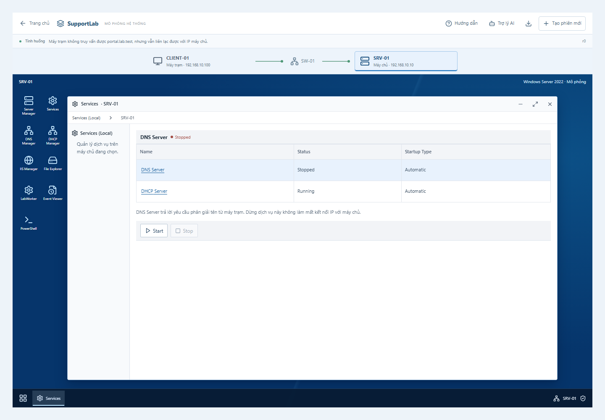
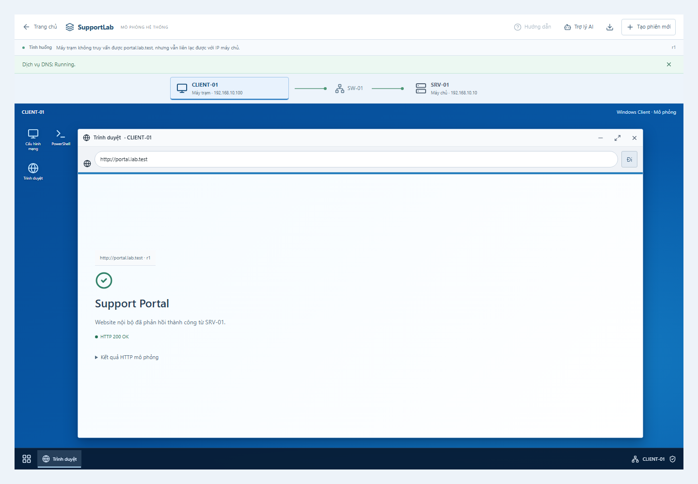

# Sử dụng desktop mô phỏng Windows

Bạn có thể chọn máy chủ hoặc máy trạm trên sơ đồ rồi thao tác trong các cửa sổ giống công cụ Windows. Hai máy dùng chung một hệ thống mô phỏng: thay đổi DNS trên máy chủ sẽ ảnh hưởng kết quả truy vấn và truy cập website từ máy trạm.

## Mở giao diện mới

Trang chủ bắt đầu bằng bốn nhóm: **DNS / DHCP**, **Web Server IIS**, **Kết nối mạng** và **Windows Server**. Chọn một nhóm, chọn tình huống, rồi chọn **Có hướng dẫn** hoặc **Tự khám phá**. Cả hai đều mở desktop immersive; chế độ có hướng dẫn chỉ focus và giải thích thao tác, không tự chạy lệnh hay sửa cấu hình.

Muốn mở hệ thống bình thường, chọn **Mở hệ thống bình thường**. Công cụ giao diện cũ vẫn có ở liên kết **Công cụ quản trị hiện có** hoặc `/system?workspace=classic` để đối chiếu.

## Hiểu sơ đồ và các cửa sổ

Sơ đồ **CLIENT-01 — SW-01 — SRV-01** luôn nằm phía trên desktop:

- **CLIENT-01:** máy trạm sử dụng mạng và truy cập website nội bộ. Bấm vào máy này để mở PowerShell, Trình duyệt hoặc Cấu hình mạng.
- **SRV-01:** máy chủ cung cấp DNS, DHCP và website IIS. Bấm vào máy này để mở Server Manager, Services, DNS Manager hoặc PowerShell.
- **SW-01:** switch nối hai máy trong mô hình; hiện chưa có cửa sổ cấu hình switch.

Mỗi biểu tượng ứng dụng chỉ cần bấm một lần để mở. Các nút ở góc phải cửa sổ cho phép thu nhỏ, phóng to hoặc đóng; bấm biểu tượng trên thanh tác vụ phía dưới để khôi phục cửa sổ. Trên màn hình hẹp, biểu tượng máy chủ tự xếp thành lưới và máy trạm thành một dải ngang, giống desktop Windows và không hiện thanh cuộn trắng của trình duyệt. Chuyển sang máy khác vẫn giữ cửa sổ và nội dung đang nhập của từng máy. Đóng cửa sổ sẽ bỏ phần nhập nháp của cửa sổ đó.

| Ứng dụng | Dùng để làm gì? | Thao tác chính |
| --- | --- | --- |
| Server Manager, trên SRV-01 | Xem và bổ sung role dịch vụ. | Chọn **Add roles and features**, sau đó **Add DNS role**, **Add DHCP role** hoặc **Add IIS role**. Menu **Tools** mở DNS, DHCP, Services, IIS, Event Viewer và PowerShell. |
| Services, trên SRV-01 | Xem và điều khiển dịch vụ DNS/DHCP. | Chọn dịch vụ rồi bấm **Start** hoặc **Stop**; quan sát trạng thái Running/Stopped. |
| DNS Manager, trên SRV-01 | Xem bản ghi ánh xạ tên `portal.lab.test` tới IP. | Bấm **portal** → xem **portal Properties** → sửa **IPv4 address** → **Apply**. |
| PowerShell, trên từng máy | Chạy lệnh chẩn đoán được hỗ trợ. | Nhập lệnh rồi bấm **Chạy**; dùng `help` để xem danh sách lệnh. |
| Cấu hình mạng, trên CLIENT-01 | Xem và thay đổi IPv4, gateway, DNS hoặc trạng thái Ethernet. | Sửa cấu hình rồi **Apply network settings**; khi dùng DHCP, có thể **Renew DHCP lease**. |
| Trình duyệt, trên CLIENT-01 | Kiểm tra HTTP qua tên miền hoặc IP trong mô phỏng. | Nhập `http://portal.lab.test` hoặc `http://192.168.10.10`, rồi bấm **Đi**. |

## Thử tình huống DNS bị dừng

Để tự quan sát, vào nhóm **DNS / DHCP**, chọn tình huống **Không phân giải được tên nội bộ** và bấm **Có hướng dẫn**. Có thể thu gọn hướng dẫn hoặc dừng dẫn thao tác để tự làm theo quy trình dưới đây.

1. Chọn **CLIENT-01**, mở **Trình duyệt** và truy cập `http://portal.lab.test`. Khi DNS bị dừng, kết quả báo không phân giải được tên, có dòng `Could not resolve host`.
2. Thử `http://192.168.10.10`. Trong tình huống mẫu, website vẫn trả về **Support Portal / HTTP 200 OK**. Điều này cho thấy có thể truy cập dịch vụ web bằng IP dù truy cập bằng tên thất bại.
3. Chọn **SRV-01**, mở **PowerShell**, chạy `Get-Service DNS`. Kết quả **Stopped** xác nhận dịch vụ DNS trên máy chủ đang dừng; chỉ lỗi truy vấn từ máy trạm chưa đủ để kết luận nguyên nhân này.
4. Mở **Services**, chọn **DNS Server**, bấm **Start**. Trạng thái chuyển thành **Running**.
5. Quay lại **CLIENT-01**, mở **PowerShell** và chạy `nslookup portal.lab.test`. Kết quả cần trả về tên `portal.lab.test` và địa chỉ `192.168.10.10`.
6. Mở lại **Trình duyệt**, nhập `http://portal.lab.test` và bấm **Đi** để kiểm tra lại. Website phải phản hồi thành công.

Nếu dịch vụ DNS đã Running nhưng tên trả về sai IP, mở **DNS Manager** trên SRV-01 để kiểm tra bản ghi. Sửa **IPv4 address** về `192.168.10.10`, bấm **Apply**, rồi chạy lại `nslookup` và truy cập website từ CLIENT-01. Việc nhập giá trị vào ô chưa làm thay đổi hệ thống; phải bấm Apply để lưu.

## Dẫn thao tác hoạt động thế nào?

Hướng dẫn DNS gồm sáu bước: **ping IP → truy vấn DNS → xem dịch vụ trên máy chủ → khởi động DNS → truy vấn lại DNS → kiểm tra HTTP**.

Phần mềm chọn đúng máy, mở cửa sổ cần dùng, điền sẵn lệnh và focus vào ô nhập hoặc nút Start kèm giải thích. Bạn tự bấm **Chạy** hoặc **Start**. Chỉ khi kết quả kiểm tra và trạng thái đáp ứng bước hiện tại, hướng dẫn mới chuyển tiếp. Nút **Đến thao tác hiện tại** đưa bạn trở lại vị trí cần thao tác nếu đang xem cửa sổ khác.

## Vì sao kết quả cũ vẫn báo lỗi sau khi sửa?

Mỗi thay đổi cấu hình có một số phiên bản, chẳng hạn **r1**, **r2**. Kết quả PowerShell và trình duyệt ghi lại phiên bản lúc kiểm tra. Sau khi cấu hình thay đổi, kết quả cũ được đánh dấu để nhắc bạn chạy lại lệnh hoặc bấm **Đi**; nó không tự biến thành kết quả thành công.

Desktop, các công cụ quản trị, trợ lý AI và bốn nhóm tình huống cùng đọc trạng thái phiên mô phỏng. Mở ứng dụng, chuyển máy hoặc thu nhỏ cửa sổ không tự đổi cấu hình. **Tạo phiên mới** đặt lại hệ thống, kết quả kiểm tra và các cửa sổ đang mở.

## Phạm vi hiện tại

Đây là giao diện Web tái hiện một số thao tác quản trị, chưa phải toàn bộ hệ điều hành Windows hay máy ảo chạy trong trình duyệt. Trình duyệt bên trong desktop chỉ kiểm tra HTTP của hệ thống mô phỏng, không dùng để lướt Internet. Các lệnh PowerShell cũng giới hạn theo danh sách được hỗ trợ; thao tác trong desktop không thay đổi hệ điều hành hoặc mạng thật của laptop.
